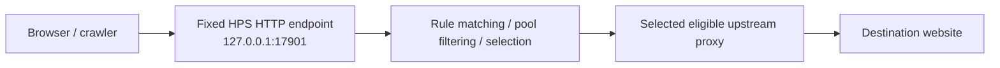
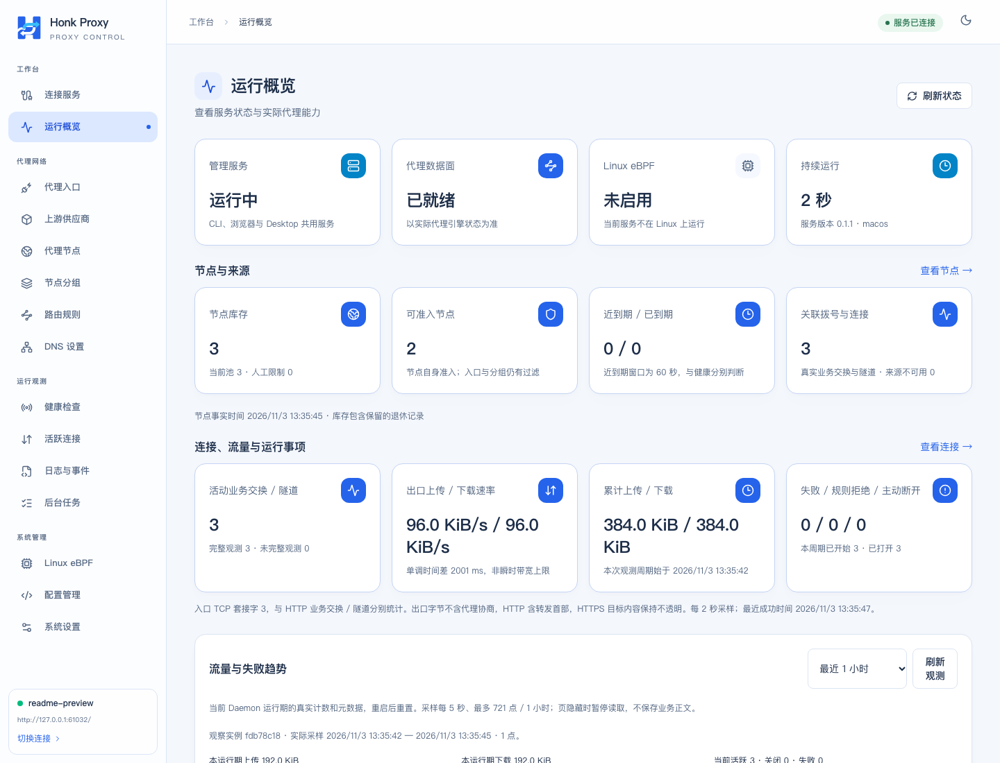
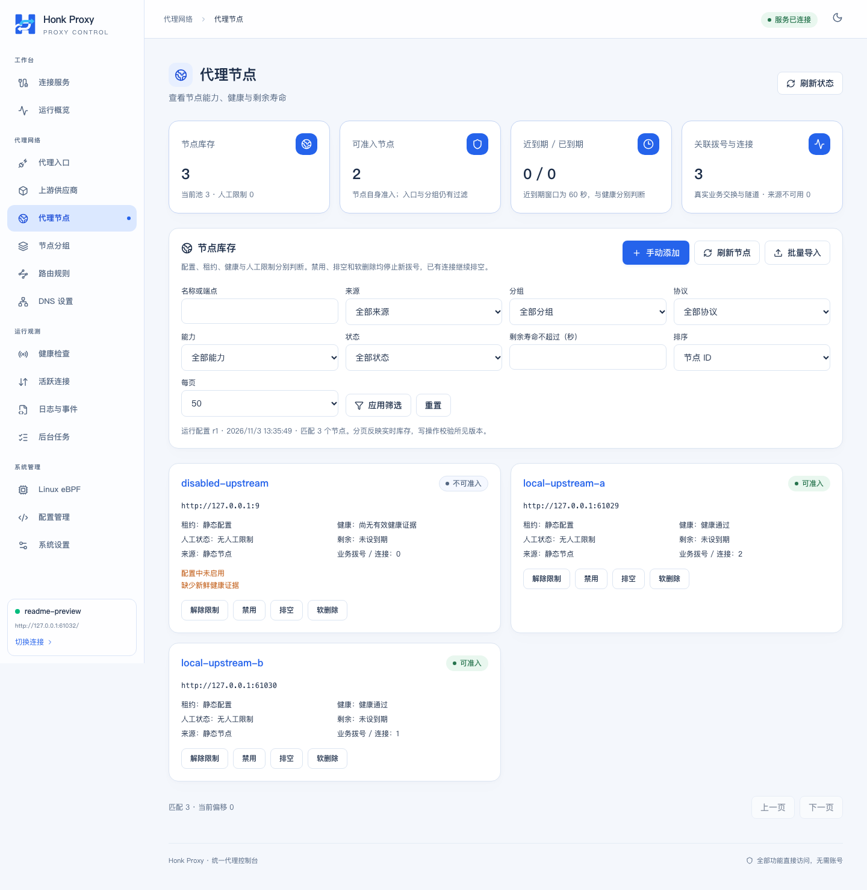
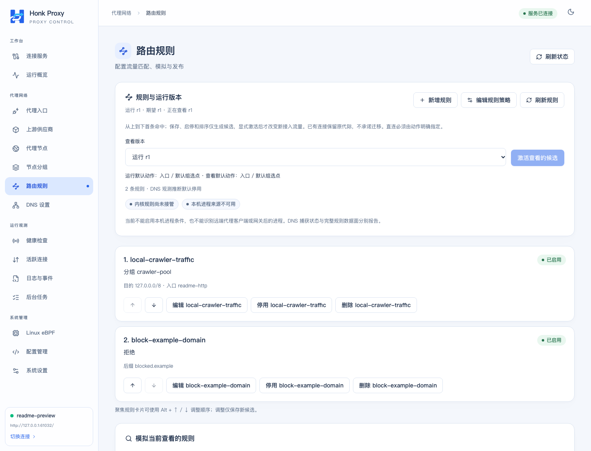
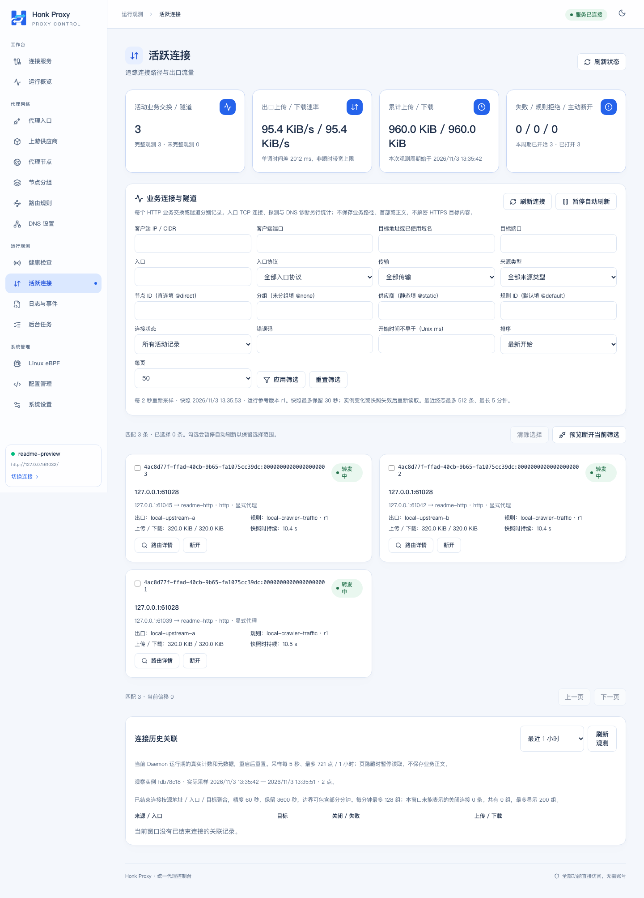
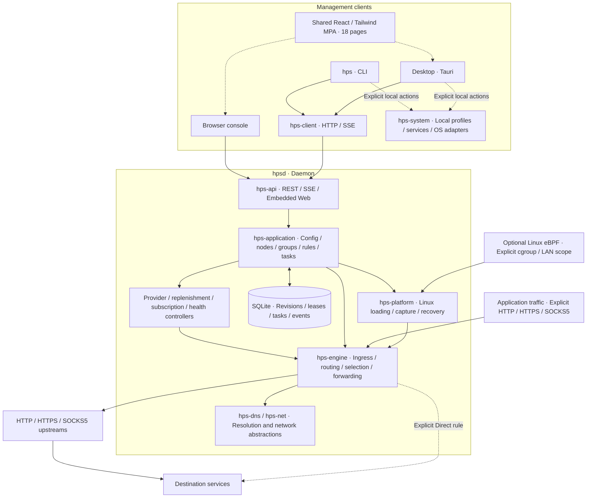

# Honk Proxy Server

English | [简体中文](README.md)

Honk Proxy Server (HPS) is a Rust proxy pool and traffic forwarding tool. It brings static proxies, standard subscriptions, and short-lived provider nodes into one runtime pool, selects egress using health, expiration, groups, and routing rules, and offers an independent CLI, headless daemon, Web console, and desktop client.

It suits individuals and controlled networks that need to manage multiple proxy sources, rotate short-lived egress, and inspect connections and failures. Servers only need `hpsd`; a browser, CLI, or desktop client can manage it. Linux also offers optional eBPF transparent capture. The proxy service is implemented independently: honk is a capability reference, with no honk crate, binary, or fork integrated.

> The default management address is `127.0.0.1:17900`. HPS has no application login, accounts, or access control. Anyone who can reach its management interface can operate the implemented features. Use an SSH tunnel or another controlled access boundary for remote administration.

## Contents

- [Fixed proxy endpoint and request flow](#fixed-proxy-endpoint-and-request-flow)
- [Runtime screenshots](#runtime-screenshots)
- [Features and platform support](#features-and-platform-support)
- [Architecture and components](#architecture-and-components)
- [Download and quick start](#download-and-quick-start)
- [Configure your first proxy egress](#configure-your-first-proxy-egress)
- [Using each component](#using-each-component)
- [Configuration and runtime data](#configuration-and-runtime-data)
- [Build from source and develop](#build-from-source-and-develop)
- [Deployment and service management](#deployment-and-service-management)
- [Backup, upgrade, and rollback](#backup-upgrade-and-rollback)
- [Validation and continuous integration](#validation-and-continuous-integration)
- [Versioning and releases](#versioning-and-releases)
- [Troubleshooting](#troubleshooting)
- [Further documentation](#further-documentation)
- [AI authorship and feedback](#ai-authorship-and-feedback)

## Fixed proxy endpoint and request flow

Configure your browser or crawler to use a fixed HPS proxy endpoint. HPS maintains the upstream pool and selects the actual egress. For example, after starting the proxy configuration shown below, set the browser's HTTP proxy host to `127.0.0.1` and port to `17901`. A crawler can keep using `http://127.0.0.1:17901` without repeatedly changing its proxy configuration as upstream nodes change.

> `127.0.0.1:17900` is the default management API and console address. In the proxy example, `127.0.0.1:17901` is the HTTP traffic ingress. Inbound addresses are configurable; clients must use the actual enabled proxy listener.



A request forwarded through an upstream proxy follows these steps:

1. The client sends a proxy request to the fixed HPS endpoint, identifying the destination. An HTTPS destination can be reached through an HTTP proxy using a CONNECT tunnel.
2. HPS uses the first matching rule to determine a node, group, or default pool, then selects an eligible node within that scope using health, remaining lifetime, capacity, and selection policy. Without routing rules, it uses the default pool policy.
3. HPS connects to the destination through the selected upstream proxy and returns the response along the connection path.

This lets crawlers and other callers keep one local proxy address while HPS handles node maintenance and egress selection. Rules can also explicitly choose Direct or Reject. Proxy forwarding rejects requests when no eligible node exists, without silently connecting directly. Egress changes apply to subsequent new connections; connection reuse or session pinning may retain a node. This does not mean every HTTP request gets a new IP, nor does it migrate existing connections or automatically replay failed requests.

## Runtime screenshots

These screenshots show a running v0.1.1 Web console. The instance uses local loopback test upstreams and destination services, with real health checks, rule-based selection, and connection traffic. The interface is currently in Chinese.

**Overview**: management and proxy readiness, eligible nodes, active connections, and cumulative traffic.



**Proxy nodes**: node sources, health, manual restrictions, and related connections, including eligible and disabled nodes.



**Routing rules**: forwarding to the `crawler-pool` group and explicit rejection, with rule order and the current runtime revision.



**Active connections**: actual CONNECT tunnels with their matched rule, egress node, and traffic in both directions.



## Features and platform support

| Capability                 | Current implementation                                                                                                                                                              |
| -------------------------- | ----------------------------------------------------------------------------------------------------------------------------------------------------------------------------------- |
| Explicit proxies           | HTTP forwarding and CONNECT, HTTPS proxy ingress, SOCKS5 CONNECT / UDP ASSOCIATE; HTTP/HTTPS/SOCKS5 upstreams                                                                       |
| Node sources               | Static configuration, manual imports, standard subscription snapshots, short-lived provider APIs; separate batch, lease, and actual expiry records                                  |
| Selection and routing      | Health and lifetime admission, fixed/fallback/round-robin/weighted/latency policies, nested groups, session pinning, first-match rules, and simulation without network side effects |
| Health and DNS             | Health evidence separated by transport and address family; System, UDP, TCP, DoT, DoH, policy resolution, and positive/negative caching                                             |
| Pool replenishment         | Watermarks, retirement forecasts, shared UTC daily budgets, cooldowns, and pausing on uncertain outcomes; automatic replenishment is off by default                                 |
| Management and observation | Configuration drafts/validation/activation/rollback, connections and traffic, background tasks, structured events/SSE, alerts, redacted diagnostics, and full SQLite backups        |
| Linux transparent proxy    | IPv4/IPv6 TCP/UDP within explicit local cgroup / LAN interface scopes, trusted local process metadata, generation changes, diagnostics, and failure cleanup; off by default         |
| Desktop                    | Shared console, local/remote profiles, independent service management, and optional tray, notifications, and user login autostart                                                   |

| Platform                    | CLI / Daemon / Web | Desktop package | Persistent service          | eBPF transparent capture                                     |
| --------------------------- | ------------------ | --------------- | --------------------------- | ------------------------------------------------------------ |
| Windows x64                 | Supported          | NSIS `.exe`     | Not implemented             | Unsupported                                                  |
| Linux x64 / ARM64           | Supported          | `.deb`          | systemd user/system service | Optional; requires an object and suitable kernel environment |
| macOS Intel / Apple Silicon | Supported          | `.dmg`          | launchd user service        | Unsupported                                                  |

Current limits:

- Standard subscriptions accept HTTP/HTTPS/SOCKS5 URIs, base64, and a strict Clash HTTP/SOCKS5 subset. Shadowsocks, VMess, VLESS, and Trojan are not supported. There is no scheduled standard subscription refresh controller; refresh is explicit.
- SOCKS5 BIND and fragmented UDP are unsupported. UDP forwarding requires a usable SOCKS5 UDP upstream or an explicit Direct rule; HTTP CONNECT cannot carry UDP. Active UDP health probing currently reports unsupported, so TCP success cannot stand in for UDP health evidence.
- Included provider adapters cover the Kuaidaili contract, generic JSON/text APIs, and Yun free proxy pages. Paid Kuaidaili account calls have not been verified. Fetching a free source successfully does not establish node health.
- General GitHub Release Linux packages are glibc builds made on Ubuntu 24.04, not static musl builds, and contain no eBPF object. They retain `release_qualified: false`. Full eBPF packages have a separate real-kernel acceptance gate.
- Linux transparent capture has an actual x86_64/aarch64 matrix on kernels 6.12.115 and 7.2.14, using ABI 4. This does not imply support for arbitrary older kernels. A strict, independent, persistent crash kill switch is not implemented.
- The system proxy adapter is currently implemented only for macOS; persistent network writes have not been accepted on the development host. Other platforms do not gain system proxy integration from this adapter. Windows packages have no cloud signing; macOS packages use ad-hoc signing without Apple notarization.

## Architecture and components

The CLI and the native part of Desktop share the Rust client; the browser calls the daemon API directly. The daemon owns proxy state and business configuration, so Desktop is optional for forwarding. Web and Desktop consume the same React/Tailwind multi-page build with 18 HTML entry points.



Management uses REST/SSE; business traffic uses the proxy engine. Without an eligible upstream, forwarding is rejected. Direct connections require an explicit Direct rule. The management API, proxy inbounds, and eBPF report their own actual states.

| Path / component                                    | Responsibility and entry point                                                                                           |
| --------------------------------------------------- | ------------------------------------------------------------------------------------------------------------------------ |
| `apps/cli` → `hps`                                  | CLI client for a target daemon, plus explicit local profile, service, and backup restore commands                        |
| `apps/daemon` → `hpsd`                              | Independent process that starts the API, controllers, forwarding engine, and persistent store                            |
| `src-tauri`                                         | Desktop native host with a separate Cargo workspace/lockfile; connects through the shared client                         |
| `web/console`                                       | Shared React/Tailwind MPA built into `dist`, used by browser and Desktop                                                 |
| `crates/api`, `client`, `web-assets`                | HTTP/SSE service and client, embedded assets, and Web Build ID validation                                                |
| `crates/application`, `domain`, `config`, `storage` | Use-case orchestration, domain contracts, TOML/configuration validation, SQLite migrations and persistence               |
| `crates/engine`, `net`, `dns`                       | Ingress protocols, upstream dialing, forwarding, selection, network abstractions, and DNS                                |
| `crates/provider`, `health`                         | Provider parsing/extraction and end-to-end probes; scheduling belongs to the application layer                           |
| `crates/platform`, `ebpf-abi`                       | Linux userspace loading/lifecycle and the shared kernel ABI                                                              |
| `crates/system`                                     | Local OS integration shared by CLI/Desktop, never exposed through the remote daemon API                                  |
| `ebpf`                                              | Kernel programs in a separate workspace; the compiled object is loaded by Linux userspace and is not a daemon executable |
| `configs`, `packaging`, `scripts`, `tests`          | Example configurations, package templates, build/release tools, and validation fixtures                                  |

The main Cargo workspace contains 17 packages: 2 applications and 15 libraries. Desktop and kernel programs build separately. Internal crates are called by the applications and need no separate deployment.

## Download and quick start

From [GitHub Releases](https://github.com/go-laoji/honk-proxy-server/releases), download the `hps-headless-<version>-<target>-ci` archive matching your system/architecture and its `.sha256` file. For Desktop, choose the platform installer. Version tag build outputs are also available as Artifacts in [GitHub Actions](https://github.com/go-laoji/honk-proxy-server/actions/workflows/build.yml), retained for 14 days by default. Ordinary branch commits and PRs do not trigger builds.

This example uses **v0.1.1 / Apple Silicon**. Substitute the filename and target for other platforms. Verify the digest in your download directory before extracting:

```sh
# macOS; on Linux use sha256sum -c with the corresponding .sha256 file
shasum -a 256 -c hps-headless-0.1.1-aarch64-apple-darwin-ci.tar.gz.sha256

tar -xzf hps-headless-0.1.1-aarch64-apple-darwin-ci.tar.gz
cd hps-headless-0.1.1-aarch64-apple-darwin-ci
./bin/hps build-info
./bin/hps config check config/hps.toml
./bin/hpsd --config config/hps.toml --data-dir ./data
```

In another terminal, from the same extracted directory:

```sh
./bin/hps --endpoint http://127.0.0.1:17900 --output json status
./bin/hps capabilities
./bin/hps ui --open
```

The default configuration starts management without a usable proxy egress. Open <http://127.0.0.1:17900/console/> to continue configuration. Start in the foreground first and use `Ctrl+C` for normal shutdown. For a disposable run, replace `--data-dir ./data` with `--ephemeral`.

In Windows PowerShell, extract the ZIP and use the `.exe` binaries:

```powershell
# Compare against the downloaded .sha256 file
Get-FileHash .\hps-headless-0.1.1-x86_64-pc-windows-msvc-ci.zip -Algorithm SHA256
# Run from the extracted directory
.\bin\hps.exe config check config\hps.toml
.\bin\hpsd.exe --config config\hps.toml --data-dir .\data
# In another terminal
.\bin\hps.exe status
```

Running CLI/Daemon requires no Node.js, Python, Tauri, or graphical session. Desktop needs the system WebView and graphical dependencies. In Desktop, open the connection page and choose **Start local service**, or connect to an existing local or remote daemon. General CI archives run directly from `bin` and do not include the full release package's `install.sh`.

## Configure your first proxy egress

Copy the [full proxy example](configs/hps.proxy.example.toml) into your own file in the source checkout, or download that example if using a release archive. It defines HTTP ingress on `17901` and SOCKS5 ingress on `17903`. The placeholder upstream is disabled. Fill in a real upstream host, port, protocol, and any credentials before enabling it:

```toml
instance_name = "my-hps"
management_listen = "127.0.0.1:17900"
log_filter = "info"

[[proxy.inbounds]]
id = "browser-http"
protocol = "http"
listen = "127.0.0.1:17901"
enabled = true

[[proxy.inbounds]]
id = "browser-socks"
protocol = "socks5"
listen = "127.0.0.1:17903"
enabled = true

[[proxy.upstreams]]
id = "my-upstream"
protocol = "http" # http / https / socks5
host = "proxy.example.net" # Replace with the actual provider address
port = 18080
enabled = false # Set true after completing the real configuration
# expires_at_unix = 1793520000 # Use the provider's actual expiry for a short-lived node
# [proxy.upstreams.credentials]
# username = "your-username"
# password = "your-password"
```

The following assumes `hps` / `hpsd` are on PATH; otherwise prefix them with `./bin/` from the extracted directory. Start with a new data directory so a previous database revision does not take precedence:

```sh
hps config check ./hps-proxy.toml
hpsd --config ./hps-proxy.toml --data-dir ./proxy-data
# In another terminal, check node health and active inbounds before testing
hps inbound list
hps node list
hps health show
curl --proxy http://127.0.0.1:17901 https://example.com/
curl --proxy socks5h://127.0.0.1:17903 https://example.com/
```

Health checking is enabled by default. New nodes require fresh successful evidence for admission; credentials, expiry, minimum remaining lifetime, rules, and capacity also affect selection. The default TCP IPv4 probe target is `https://www.baidu.com/`; TCP IPv6 probing is off by default. You can choose your own stable target in the health policy. Use the health page or `hps health probe --help` for active probing. Unknown or stale evidence is not shown as healthy.

An HTTPS **proxy ingress** needs a certificate/private key; an HTTPS **upstream** validates the provider's certificate name. These are distinct from HTTPS at the destination website. Relative certificate paths resolve against the TOML directory. See [explicit proxy usage](docs/explicit-proxy-usage.md).

## Using each component

### Daemon: `hpsd`

```sh
hpsd --config /absolute/hps.toml --data-dir /absolute/hps-data
hpsd --ephemeral --listen 127.0.0.1:17900
hpsd --build-info
```

`--config` loads TOML; `--listen` and `--instance-name` override their startup values. The default data directory is `.hps` under the working directory; use an explicit absolute path for deployment. `--data-dir` and `--ephemeral` are mutually exclusive. Logs are JSON on stderr, controlled by `log_filter`. Unix `SIGTERM` and `Ctrl+C` trigger normal shutdown.

### CLI: `hps`

```sh
hps --version                     # Local CLI version
hps version                       # Target daemon version
hps --endpoint http://127.0.0.1:17900 --output json status
hps config show
hps provider list
hps subscription list
hps node list
hps group show
hps rule show
hps health show
hps dns show
hps connection list
hps task list
hps event list
hps ui                            # Prints a URL; --open opens the browser
```

Choose a connection with `--endpoint` / `HPS_ENDPOINT`, a saved `--profile`, and optionally `--ca-cert` / `HPS_CA_CERT`. `--endpoint` and `--profile` are mutually exclusive. Without either, the selected profile is used, falling back to the default address. `--timeout` defaults to 10 seconds, with a range of 1–300; scripts can use `--output json`. Run `hps <component> --help` for required mutation, simulation, and task parameters.

### Web console

The full daemon embeds Web at `/console/`. After selecting a target on the connection page, manage inbounds, providers, nodes, groups, rules, health, DNS, connections, tasks, events, Linux state, and configuration revisions. Background task state is authoritative; leaving a page does not cancel accepted work.

A minimal daemon built with `--no-default-features` has no console. Browser and Desktop display state from the same target API without inserting demo nodes.

### Desktop

After installing the platform package, create a `local` or `remote` profile on the connection page. A `local` profile accepts only loopback addresses and enables explicit local service actions. A `remote` profile never enables local OS controls, even when its address is a local SSH tunnel. Custom HTTPS CAs use absolute paths to local PEM files.

Desktop runs as an ordinary user and refuses root execution. Closing/quitting Desktop does not stop independent services. Tray residency, OS alert notifications, and Desktop login autostart are optional and off by default. Desktop login autostart and daemon service startup are separate settings. See the deployment steps below and the [Desktop/service guide](docs/desktop-service-usage.md).

### Linux eBPF

Start with read-only checks of the target daemon environment and capture state:

```sh
hps linux preflight
hps linux diagnostics
hps linux capture status
```

These commands do not load BPF or modify routes. Actual transparent capture requires a separately built object, BTF/cgroup2/bpffs, a suitable kernel and privileges, and explicit cgroup/LAN interface configuration. Passing preflight is not proof of active capture. Follow candidate review/activation results when changes require a restart.

Run real loading, route changes, and kernel tests only in confirmed isolated Linux VMs/containers with owned cgroups/network namespaces. Do not capture the host's default scope. See [eBPF build and validation](docs/linux-ebpf-usage.md), [transparent capture](docs/linux-transparent-usage.md), and [DNS](docs/dns-usage.md).

## Configuration and runtime data

TOML is the **initialization input for a new data directory**. When a database exists, startup uses the desired configuration revision stored in SQLite. Editing the original TOML and restarting does not automatically overwrite it. Use the console workspace or CLI draft, validation, candidate save, and explicit activation flow for ongoing changes.

```sh
hps init --config ./hps.toml       # Generate a base config; refuses overwrite
hps config check ./hps.toml        # Local file validation only
hps config workspace
hps config validate --help
hps config activate --help
hps config rollback --help
hps config export --path ./exported-config.toml
```

Configuration actions use revision/epoch checks to prevent stale overwrites. Reload current state after a conflict. Saving a draft does not mean activation succeeded, and results may require a restart. Rollback uses retained revisions and actual validation; do not edit SQLite manually.

| Data                       | Default location / behavior                                                                                                                                                         |
| -------------------------- | ----------------------------------------------------------------------------------------------------------------------------------------------------------------------------------- |
| Daemon database            | `.hps/hps.sqlite3`, or the directory chosen by `--data-dir`; holds configuration history, credentials, leases, tasks, and more                                                      |
| CLI/Desktop local profiles | macOS: `~/Library/Application Support/honk-proxy-server`; Linux: `$XDG_CONFIG_HOME/honk-proxy-server` or `~/.config/honk-proxy-server`; Windows: `%LOCALAPPDATA%\honk-proxy-server` |
| Separate client directory  | `HPS_CLIENT_STATE_DIR`, which must be absolute; does not change the daemon data directory                                                                                           |
| Managed service files      | Owned binary, config, data, and manifest under `services/<id>/` in the client directory; OS units are installed separately by platform                                              |
| Web build                  | `dist`; the manifest and Web Build ID verify shared daemon/Desktop assets                                                                                                           |

Configurations, databases, and backups may contain provider credentials; restrict access. Redacted diagnostics and full database backups serve different purposes and are not interchangeable.

## Build from source and develop

### Toolchains

- Rust **1.98.1**, pinned by [rust-toolchain.toml](rust-toolchain.toml). Install using [rustup](https://rust-lang.org/tools/install/).
- Web/Desktop: Node.js **24.15.0**, pnpm **12.10.1**. Follow the [pnpm installation guide](https://pnpm.io/installation) for the required version.
- Packaging/version scripts: Python **3.11+**, available as `python`. Some system `python3` installations are older.
- Desktop: install the [Tauri 2 prerequisites](https://v2.tauri.app/start/prerequisites/), such as Xcode Command Line Tools on macOS, MSVC/WebView2 on Windows, and WebKitGTK 4.1 development libraries on Linux.
- eBPF separately requires `nightly-2026-09-01`, `rust-src`, and `bpf-linker 0.12.0`. Ordinary CLI/Daemon builds do not need nightly.

Set the network protection variable for development processes. Cargo forces it already, but directly launched development binaries/apps must inherit it explicitly. Do not perform actual system proxy, DNS, or route write acceptance on the development Mac:

```sh
export HPS_FORBID_HOST_NETWORK_CHANGES=1
# PowerShell: $env:HPS_FORBID_HOST_NETWORK_CHANGES = "1"
```

### Rust-only CLI / minimal daemon

```sh
cargo build --locked -p hps-cli -p hps-daemon --no-default-features
./target/debug/hps init --config hps.toml
./target/debug/hpsd --config hps.toml
```

Outputs are `target/debug/hps` and `hpsd` (`.exe` on Windows). This build excludes Web and needs no Node or Tauri. For CLI alone, use `cargo build --locked -p hps-cli`.

### Full build with shared Web

```sh
pnpm install --frozen-lockfile
pnpm build
cargo build --locked --release -p hps-cli -p hps-daemon
./target/release/hpsd --config configs/hps.example.toml --data-dir ./dev-data
```

Open <http://127.0.0.1:17900/console/>. `pnpm build` creates `dist`, then Rust's default `web-ui` feature embeds it. Node is not needed at runtime.

### Browser and Desktop development

Browser development requires the daemon above. In Desktop development, start the local service from the connection page.

```sh
pnpm dev             # Browser: http://localhost:1420; /api proxies to 127.0.0.1:17900
# Or
HPS_FORBID_HOST_NETWORK_CHANGES=1 pnpm run tauri dev  # Builds Web and starts Vite on port 1420
```

On the connection page, choose **Start local service**. The development instance stores configuration and data separately from the release app. See the [Desktop local service guide](docs/desktop-service-usage.md) for controls and storage paths.

### Build platform packages

Install dependencies, build Web once, and commit the source to be packaged first. Run on the native system matching the target; this example uses Apple Silicon:

```sh
python -B scripts/build-ci.py headless --target aarch64-apple-darwin
python -B scripts/build-ci.py desktop --target aarch64-apple-darwin
```

Substitute the corresponding target: Windows `x86_64-pc-windows-msvc`; Linux `x86_64-unknown-linux-gnu` / `aarch64-unknown-linux-gnu`; macOS `x86_64-apple-darwin` / `aarch64-apple-darwin`. These commands do not provide arbitrary cross-platform packaging from any host.

Outputs go to `target/ci-build/artifacts/headless` and `desktop`. The scripts check source state, version, architecture, and Web hashes, and refuse to overwrite an existing output directory of the same kind. Save and move prior artifacts before rerunning; do not delete an installed user app or other target directories.

Full Linux eBPF packages additionally require an object and real-kernel reports as described in the [release guide](docs/release-usage.md). Compiling the object alone does not pass the release gate:

```sh
rustup toolchain install nightly-2026-09-01 --component rust-src --profile minimal
# First prepare the pinned bpf-linker as described in the eBPF guide
./scripts/build-ebpf.sh
```

The object is `ebpf/target/bpfel-unknown-none/release/hps-ebpf`. `packaging/Dockerfile.builder` is a build tools image; test Dockerfiles are validation fixtures. Neither is a ready-made production runtime deployment.

## Deployment and service management

### Foreground or remote server

Give each instance its own configuration, data directory, and listening ports. Servers need no Desktop. Start with `hpsd --config ... --data-dir ...` in the foreground and verify it. Management binds only to loopback by default. For remote administration, forward its port:

```sh
# Run locally against a server you are authorized to access
ssh -N -L 27900:127.0.0.1:17900 user@server
# In another local terminal
hps --endpoint http://127.0.0.1:27900 status
# Browser: http://127.0.0.1:27900/console/
```

Do not expose the unauthenticated management interface directly to the public Internet. Business proxy inbounds and management bind addresses are configured separately. With your own TLS/access boundary, still verify reachability and certificates; see the [configuration guide](docs/configuration-usage.md).

### Persistent services on macOS / Linux

Prepare real, validated absolute binary/configuration paths. The configured management listener must match the loopback address. These commands **install and control a local OS service**; run them on the machine selected for deployment:

```sh
hps service --local --id local install \
  --binary /absolute/bin/hpsd \
  --config /absolute/config/hps.toml \
  --address http://127.0.0.1:17900/
hps service --local --id local start --expected-endpoint http://127.0.0.1:17900/
hps service --local --id local status
hps --endpoint http://127.0.0.1:17900 status
# For maintenance
hps service --local --id local stop --expected-endpoint http://127.0.0.1:17900/
```

Installation copies the binary and resolved configuration into an owned durable directory. Starting remains explicit. A temporary child process from an extraction directory is not used as a substitute for a service. `service --local` rejects global `--endpoint` / `--profile` and never performs remote service actions.

macOS uses launchd user services; Linux uses systemd user services. Linux administrators can use `install --system` for a system service, which eBPF configuration requires. Whether a Linux user service survives logout depends on the system's user session/linger policy. Do not run the whole Desktop as root.

Use `uninstall --expected-endpoint ...` to remove owned OS registration while retaining configuration, binary, and database. Foreign unit/path/endpoint conflicts are rejected. Existing data directories still follow database configuration revision rules. On Windows, deploy as a foreground daemon or manage its process externally; built-in Windows Service installation is unavailable.

### Liveness and readiness

```sh
curl http://127.0.0.1:17900/healthz
curl -i http://127.0.0.1:17900/readyz
hps --output json status
hps capabilities
```

`/healthz` reports management process liveness. `/readyz` returns 200 only with a running proxy inbound and admissible egress. It can return 503 when unconfigured, all inbounds are stopped, nodes expire, health evidence is missing, or shutdown is in progress. HTTPS ingress also requires a valid certificate. Disabling health is reported as untested admission. eBPF compiled/configured/attached/ready states are separate; explicit proxy readiness does not mean transparent capture is enabled.

## Backup, upgrade, and rollback

Create a consistent online SQLite backup, then inspect it locally using the SHA256 returned by the download:

```sh
hps --timeout 120 --output json backup create ./hps-backup.sqlite3
# Replace the placeholder with the real SHA256 returned by the download
hps backup inspect ./hps-backup.sqlite3 --sha256 REPLACE_WITH_SHA256
```

Full backups **contain credentials** and belong in private storage. They include database configuration, leases, tasks, events, and related state. External TLS files, Desktop preferences, OS services, and system network configuration are excluded and must be prepared separately for migration.

Before upgrading, retain a backup and stop the target daemon. Replace the binaries, restart, and check version, configuration state, readiness, and a real proxy request. The package's default TOML does not overwrite an existing database. A binary-only downgrade requires a compatible schema; otherwise stop the service and restore the full pre-upgrade backup:

```sh
# Stop the target using its existing service manager first; run on the target machine
hps backup restore ./hps-backup.sqlite3 --offline \
  --data-dir /absolute/hps-data --sha256 REPLACE_WITH_SHA256
# Explicitly restart the target daemon after successful restoration
```

Restore targets an existing local data directory and requires an exclusive lock. It rejects remote endpoint/profile selection and does not stop/restart services itself. The old database is retained. Do not copy a live SQLite main file as a backup or alter the schema version to force an old binary to read it. See [backup and diagnostics](docs/backup-desktop-diagnostics-usage.md).

## Validation and continuous integration

Build Web before workspace validation, using the network protection environment described above:

```sh
pnpm install --frozen-lockfile
pnpm typecheck
pnpm format:check
pnpm build
cargo fmt --all --check
cargo test --locked --workspace
cargo clippy --locked --workspace --all-targets -- -D warnings
cargo test --locked --manifest-path src-tauri/Cargo.toml
pnpm exec playwright install chromium
pnpm test:e2e
python -B -m unittest discover -s tests/ci -p 'test_*.py' -v
python -B -m unittest discover -s tests/release-management -p 'test_*.py' -v
```

Desktop checks require platform SDK/graphical development dependencies. Playwright starts an owned ephemeral daemon at `127.0.0.1:17991` and does not reuse an existing server. Real Linux forwarding requires separate isolated-kernel acceptance; management API tests cannot replace it. On the development Mac, only read-only network checks and transactions without OS writes are allowed. Do not rerun old network-writing test binaries from before the recorded incident.

[Cross-platform builds](.github/workflows/build.yml) runs only when a `v*` version tag is pushed. It builds Web once, then five native CLI/Daemon and Desktop pairs. Outputs are uploaded as Artifacts; after every build succeeds, original packages, manifests, and checksums are synchronized to the matching GitHub Release. Branch pushes, PRs, and manual dispatch do not start new builds, so documentation commits do not launch CI. Full eBPF releases use the separate [release.yml](.github/workflows/release.yml), also triggered only by `v*` tag pushes, with the actual kernel gates retained. See [cross-platform CI](docs/ci-builds-usage.md).

## Versioning and releases

The Cargo workspace owns the product version. A hook synchronizes Desktop, eBPF, frontend metadata, and the three Cargo lockfiles. `cargo-release` **does not publish to a registry or push automatically**; it creates a local version commit and `v<version>` tag.

```sh
cargo install cargo-release --locked --version 1.1.7
python -B scripts/versioning.py --check
cargo release patch --workspace             # Dry-run by default
# When intentionally releasing, execute in a clean release checkout:
cargo release patch --workspace --execute   # Update versions and create local commit/tag
```

The version hook uses offline dependencies. Prepare the locked caches for all three workspaces as described in the [version management guide](docs/version-management-usage.md). GitHub Actions publishes Release assets only after a separately authorized version tag push. A local tag does not trigger it. Git Flow finish and main-branch integration are separate operations.

## Troubleshooting

| Symptom                                                     | First checks                                                                                                                                             |
| ----------------------------------------------------------- | -------------------------------------------------------------------------------------------------------------------------------------------------------- |
| Console works, but forwarding fails / `/readyz` returns 503 | Running inbounds, enabled real upstreams that have not expired, fresh health evidence, matching rules, capacity, node exclusion reasons, and task events |
| Editing TOML and restarting has no effect                   | Check for an existing SQLite data directory; activate a revision in the workspace, or explicitly choose a new directory for a separate test              |
| `/console/` is unavailable                                  | Check for a minimal `--no-default-features` build; full builds need `dist` first                                                                         |
| HTTP works but UDP fails                                    | Check SOCKS5 UDP upstream capability and UDP rules/admission; HTTP CONNECT or TCP health does not establish UDP support                                  |
| Service starts but API is unavailable                       | Distinguish OS service state, process, actual endpoint/TLS, API liveness, and proxy readiness; inspect daemon JSON logs                                  |
| Linux package lacks eBPF / preflight reports unsupported    | General packages omit the object; non-Linux is unsupported, and real capture additionally needs a suitable kernel, object, and configuration             |
| Packaging rejects source state or output directory          | Commit packaging inputs, check versions/shared Web, and save/move old outputs before rerunning; do not overwrite existing manifests                      |

## Further documentation

The detailed guides below are currently primarily in Chinese. This English README provides the corresponding project introduction and operational entry points.

| Topic                       | Documentation                                                                                                                                                                                                                                                                         |
| --------------------------- | ------------------------------------------------------------------------------------------------------------------------------------------------------------------------------------------------------------------------------------------------------------------------------------- |
| Configuration and ingress   | [Configuration revisions](docs/configuration-usage.md), [explicit proxies](docs/explicit-proxy-usage.md), [proxy example](configs/hps.proxy.example.toml)                                                                                                                             |
| Sources and pool management | [Providers](docs/providers-usage.md), [replenishment](docs/replenishment-usage.md), [subscriptions](docs/protocol-subscriptions-usage.md), [nodes](docs/node-management-usage.md)                                                                                                     |
| Traffic policy              | [Health](docs/health-usage.md), [DNS](docs/dns-usage.md), [groups](docs/groups-usage.md), [routing rules](docs/routing-rules-usage.md)                                                                                                                                                |
| Observation and operations  | [Connections](docs/connections-usage.md), [tasks/events](docs/tasks-events-usage.md), [observation/alerts](docs/observability-usage.md), [backup/diagnostics](docs/backup-desktop-diagnostics-usage.md)                                                                               |
| Platforms and delivery      | [Desktop/services](docs/desktop-service-usage.md), [Linux eBPF](docs/linux-ebpf-usage.md), [transparent proxy](docs/linux-transparent-usage.md), [packages](docs/release-usage.md), [CI](docs/ci-builds-usage.md), [versioning](docs/version-management-usage.md)                     |
| Design and progress         | [Technical architecture](docs/technical-architecture-plan.md), [console checklist](docs/console-feature-checklist.md), [development tasks](docs/development-task-checklist.md), [Git Flow](docs/git-flow-workflow.md), [future platform contracts](docs/future-platform-contracts.md) |

Usage guides describe current implementation. Plans and future contracts do not mean a capability is enabled. Actual verification scope is recorded under `docs/validation/`; read historical records together with their source revision and later corrections.

## AI authorship and feedback

The current program was written entirely by AI and is not guaranteed to be free of bugs. If you encounter a problem or have a suggestion, please open a [GitHub Issue](https://github.com/go-laoji/honk-proxy-server/issues). For bug reports, include the program version, operating system, reproduction steps, and redacted logs where possible. Do not include passwords, proxy credentials, or other private information.
