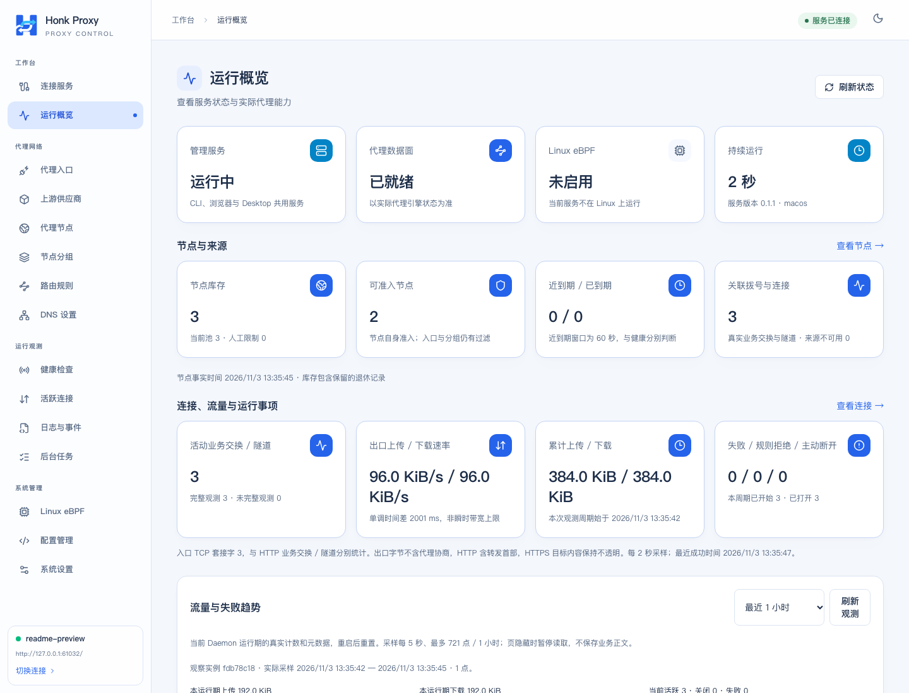
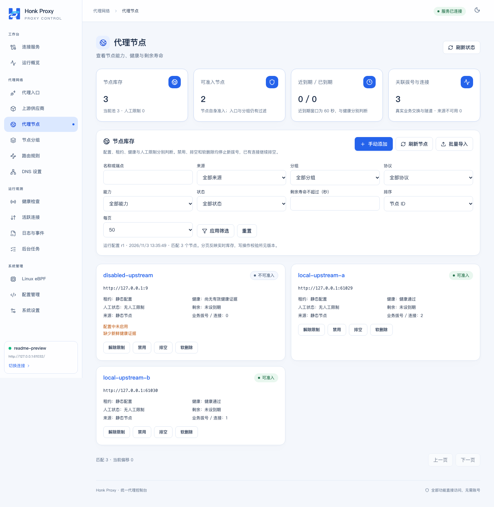
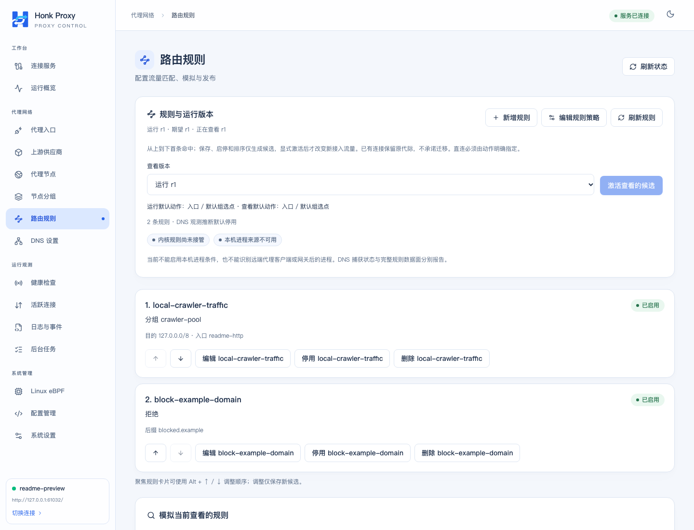
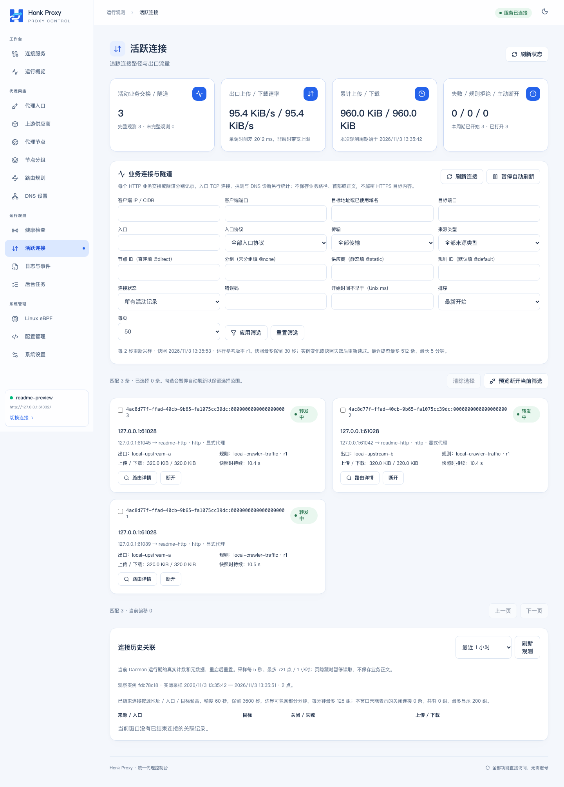
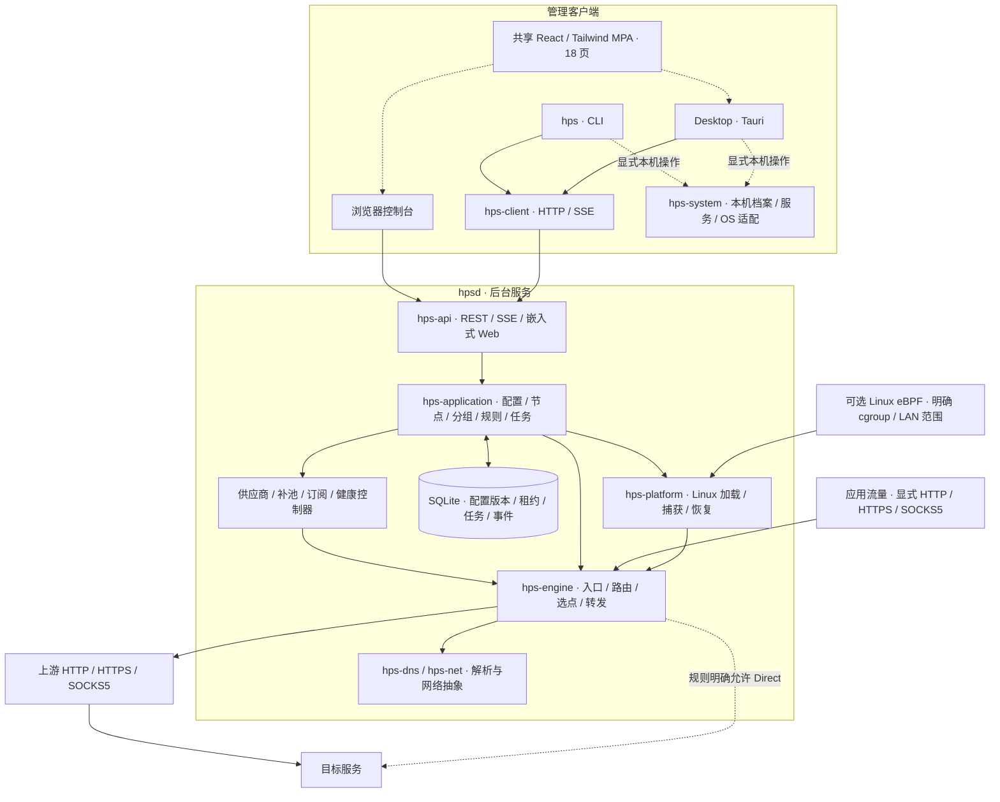

# Honk Proxy Server

[English](README.en.md) | 简体中文

Honk Proxy Server（HPS）是使用 Rust 实现的代理池与流量转发工具。它把静态代理、标准订阅和短效供应商节点汇集到同一运行池，根据健康、有效期、分组与路由规则选择出口，并提供独立 CLI、无桌面 Daemon、Web 控制台和 Desktop 客户端。

适合需要统一管理多个代理来源、轮换短效出口、观察连接和失败原因的个人或受控网络环境。服务器只需运行 `hpsd`；浏览器、CLI 和 Desktop 都可以管理它。Linux 还提供可选的 eBPF 透明接管。项目自主实现代理服务，honk 仅作为能力参考，不集成其 crate、二进制或 fork。

> 默认管理地址是 `127.0.0.1:17900`。项目没有登录、帐号或权限验证，能够访问管理接口的调用者可以操作已实现的功能。远程管理应通过 SSH 隧道或其他受控访问边界。

## 目录

- [固定代理入口与调用链路](#固定代理入口与调用链路)
- [运行截图](#运行截图)
- [功能与平台支持](#功能与平台支持)
- [架构与组件](#架构与组件)
- [下载与快速开始](#下载与快速开始)
- [配置第一个代理出口](#配置第一个代理出口)
- [各组件用法](#各组件用法)
- [配置与运行数据](#配置与运行数据)
- [源码编译与开发](#源码编译与开发)
- [部署与服务管理](#部署与服务管理)
- [备份升级与回退](#备份升级与回退)
- [验证与持续集成](#验证与持续集成)
- [版本与发布](#版本与发布)
- [常见问题](#常见问题)
- [详细文档](#详细文档)
- [AI 编写说明与反馈](#ai-编写说明与反馈)

## 固定代理入口与调用链路

浏览器或爬虫程序只需固定连接 HPS 的代理入口，由 HPS 维护上游代理池并选择实际出口。例如，使用下文代理样例启动后，浏览器可以将 HTTP 代理主机设为 `127.0.0.1`、端口设为 `17901`；爬虫程序则固定使用 `http://127.0.0.1:17901`，无需随着上游节点变化频繁修改自身的代理配置。

> `127.0.0.1:17900` 默认用于管理 API 和控制台；代理样例中的 `127.0.0.1:17901` 才是 HTTP 业务代理入口。入口地址可以配置，客户端应填写实际启用的代理监听地址。


一次经上游代理转发的调用按以下链路执行：

1. 客户端向固定的 HPS 入口发送代理请求，携带要访问的目标站点；HTTPS 目标可通过 HTTP 代理的 CONNECT 建立隧道。
2. HPS 按首条匹配的规则确定节点、分组或默认池，并在允许的候选范围内，根据健康、剩余有效期、容量和选点策略选择可用节点。未配置路由规则时，按默认池策略选择出口。
3. HPS 通过选中的上游代理连接目标站点，再沿连接链路将响应传回客户端。

这样，爬虫等调用方可以始终使用同一个本地代理地址，把节点维护和出口选择交给 HPS。规则也可明确选择 Direct 或 Reject；代理转发没有合格节点时会拒绝，不会隐式直连。出口变化作用于后续新建连接，连接复用或会话固定可能继续使用原节点，因此不代表每个 HTTP 请求都更换 IP，也不会迁移已有连接或自动重放失败请求。

## 运行截图

以下截图来自实际运行的 v0.1.1 Web 控制台。截图实例使用本地回环测试上游与目标服务，展示真实的健康检测、规则选点和连接流量；界面当前为中文。

**运行概览**：查看管理服务与代理数据面的状态、节点准入数量、活跃连接和累计流量。



**代理节点**：统一查看节点来源、健康、人工限制与关联连接，对比可准入节点和已禁用节点。



**路由规则**：展示转发到 `crawler-pool` 分组和明确拒绝两类规则，以及规则顺序与当前运行版本。



**活跃连接**：查看实际 CONNECT 隧道命中的规则、出口节点与双向流量。



## 功能与平台支持

| 能力           | 当前实现                                                                                                       |
| -------------- | -------------------------------------------------------------------------------------------------------------- |
| 显式代理       | HTTP 转发与 CONNECT、HTTPS 代理入口、SOCKS5 CONNECT / UDP ASSOCIATE；HTTP/HTTPS/SOCKS5 上游                    |
| 节点来源       | 静态配置、手动导入、标准订阅快照、短效供应商 API；批次、租约与真实有效期分别记录                               |
| 选点与路由     | 健康和寿命准入、固定/回退/轮询/加权/延迟策略、嵌套分组、会话固定、首条匹配规则与无网络副作用的模拟             |
| 健康与 DNS     | 分协议/地址族的健康证据；System、UDP、TCP、DoT、DoH，策略解析和正负缓存                                        |
| 补池           | 水位、退休预测、统一 UTC 每日预算、冷却与不确定结果暂停；默认关闭自动补池                                      |
| 管理与观测     | 配置草稿/校验/激活/回滚、连接和流量、后台任务、结构化事件/SSE、告警、脱敏诊断与完整 SQLite 备份                |
| Linux 透明代理 | 明确本机 cgroup / LAN 网卡范围的 IPv4/IPv6 TCP/UDP，可信本机进程元数据、代际切换、状态诊断与故障回收；默认关闭 |
| Desktop        | 共享控制台、本机/远端档案、独立服务管理，以及可选托盘、通知和用户登录自启                                      |

| 平台                        | CLI / Daemon / Web | Desktop 包  | 持久服务              | eBPF 透明接管            |
| --------------------------- | ------------------ | ----------- | --------------------- | ------------------------ |
| Windows x64                 | 支持               | NSIS `.exe` | 尚未实现              | 不支持                   |
| Linux x64 / ARM64           | 支持               | `.deb`      | systemd 用户/系统服务 | 可选，另需对象与内核条件 |
| macOS Intel / Apple Silicon | 支持               | `.dmg`      | launchd 用户服务      | 不支持                   |

能力边界：

- 标准订阅支持 HTTP/HTTPS/SOCKS5 URI、base64 和严格的 Clash HTTP/SOCKS5 子集。尚不支持 Shadowsocks、VMess、VLESS、Trojan 等协议，也没有标准订阅定时刷新调度器；刷新需显式触发。
- SOCKS5 不支持 BIND 或分片 UDP。UDP 数据面要求可用的 SOCKS5 UDP 上游或明确的 Direct 规则；HTTP CONNECT 不承载 UDP。当前主动 UDP 健康探测报告不支持，不能用 TCP 成功代替 UDP 健康证据。
- 内置供应商包括快代理契约适配、通用 JSON/文本 API 与云代理免费页面。快代理付费帐号实际调用未验证；免费来源提取成功不代表节点健康。
- 通用 GitHub Release Linux 包为 Ubuntu 24.04 环境构建的 glibc 包，不是静态 musl 包，且不包含 eBPF 对象。它们保留 `release_qualified: false` 标记。完整 eBPF 包有独立的实际内核验收门槛。
- Linux 透明代理已有 x86_64/aarch64、6.12.115 与 7.2.14 的实际内核矩阵，当前 ABI 为 4；这不代表任意旧内核均受支持。严格独立、持久的崩溃 kill switch 仍未实现。
- 系统代理适配目前仅有 macOS 实现，开发宿主上的持久网络写入未验收；其他平台不能据此视为具有系统代理集成。Windows 包未云签名，macOS 包仅 ad-hoc 签名、未 Apple 公证。

## 架构与组件

CLI 与 Desktop 的原生部分使用同一 Rust 客户端；浏览器直接访问 Daemon API。所有代理状态和业务配置由 Daemon 管理，Desktop 不是转发必需组件。Web 与 Desktop 复用同一份包含 18 个 HTML 入口的 React/Tailwind 多页面构建产物。



管理请求走 REST/SSE；业务流量走代理引擎。没有合格上游时拒绝转发，不隐式回退直连，只有规则显式选择 Direct 才直连。管理 API、代理入口和 eBPF 各自报告实际状态。

| 路径 / 组件                                         | 职责与使用入口                                                                     |
| --------------------------------------------------- | ---------------------------------------------------------------------------------- |
| `apps/cli` → `hps`                                  | 命令行客户端；查询/修改目标 Daemon，另提供明确的本机档案、服务、备份恢复命令       |
| `apps/daemon` → `hpsd`                              | 独立服务进程；启动 API、控制器、转发引擎和持久存储                                 |
| `src-tauri`                                         | Desktop 原生宿主；独立 Cargo workspace/锁文件，通过客户端连接 Daemon               |
| `web/console`                                       | 共享 React/Tailwind MPA，构建到 `dist`；浏览器与 Desktop 共用                      |
| `crates/api`、`client`、`web-assets`                | HTTP/SSE 服务与客户端、嵌入资源及 Web Build ID 校验                                |
| `crates/application`、`domain`、`config`、`storage` | 用例编排、领域契约、TOML/配置校验、SQLite 迁移与持久化                             |
| `crates/engine`、`net`、`dns`                       | 入口协议、出口拨号、转发、选点、网络抽象与 DNS                                     |
| `crates/provider`、`health`                         | 供应商解析/提取与端到端探测；调度在 application 层                                 |
| `crates/platform`、`ebpf-abi`                       | Linux 用户态加载/生命周期与共享内核 ABI                                            |
| `crates/system`                                     | CLI/Desktop 共用的本机 OS 集成，不通过远端 Daemon API 暴露                         |
| `ebpf`                                              | 独立 workspace 的内核程序；编译出的对象由 Linux 用户态加载，不能直接当 Daemon 运行 |
| `configs`、`packaging`、`scripts`、`tests`          | 配置样例、打包模板、构建/发布工具与验证夹具                                        |

主 Cargo workspace 共 17 个包（2 个应用、15 个库）；Desktop 与内核程序单独构建。内部 crate 由应用调用，无需逐个部署。

## 下载与快速开始

从 [GitHub Releases](https://github.com/go-laoji/honk-proxy-server/releases) 下载匹配系统/架构的 `hps-headless-<版本>-<target>-ci` 压缩包及对应 `.sha256`。Desktop 选择平台安装包。版本标签构建的产物也可在 [GitHub Actions](https://github.com/go-laoji/honk-proxy-server/actions/workflows/build.yml) 的 Artifacts 下载，默认保留 14 天；普通分支提交和 PR 不触发构建。

以下以 **v0.1.1 / Apple Silicon** 为例，其他平台替换文件名与 target。先在下载目录核对摘要，再解压：

```sh
# macOS；Linux 可用 sha256sum -c 对应的 .sha256 文件
shasum -a 256 -c hps-headless-0.1.1-aarch64-apple-darwin-ci.tar.gz.sha256

tar -xzf hps-headless-0.1.1-aarch64-apple-darwin-ci.tar.gz
cd hps-headless-0.1.1-aarch64-apple-darwin-ci
./bin/hps build-info
./bin/hps config check config/hps.toml
./bin/hpsd --config config/hps.toml --data-dir ./data
```

另开终端，在同一解压目录中：

```sh
./bin/hps --endpoint http://127.0.0.1:17900 --output json status
./bin/hps capabilities
./bin/hps ui --open
```

默认配置先启动管理服务，没有可用代理出口；打开 <http://127.0.0.1:17900/console/> 继续配置。首次可先在前台运行，`Ctrl+C` 正常退出。若需要测试且不保留状态，可将 `--data-dir ./data` 换成 `--ephemeral`。

Windows PowerShell 解压 ZIP 后使用 `.exe`：

```powershell
# 与下载的 .sha256 文件内容比较
Get-FileHash .\hps-headless-0.1.1-x86_64-pc-windows-msvc-ci.zip -Algorithm SHA256
# 在解压目录运行
.\bin\hps.exe config check config\hps.toml
.\bin\hpsd.exe --config config\hps.toml --data-dir .\data
# 另一个终端
.\bin\hps.exe status
```

CLI/Daemon 运行不需要 Node.js、Python、Tauri 或图形会话。Desktop 需要系统 WebView/图形依赖，并连接独立运行的 Daemon；安装 Desktop 不代表服务已经启动。通用 CI 压缩包直接运行 `bin` 下的程序，不含完整发行包的 `install.sh`。

## 配置第一个代理出口

在源码目录复制 [完整代理示例](configs/hps.proxy.example.toml) 为自己的配置文件；发行包用户可下载该样例。样例提供 HTTP `17901` 和 SOCKS5 `17903` 入口，供应商占位上游默认禁用。先填写真实上游主机、端口、协议及必要凭据，再启用：

```toml
instance_name = "my-hps"
management_listen = "127.0.0.1:17900"
log_filter = "info"

[[proxy.inbounds]]
id = "browser-http"
protocol = "http"
listen = "127.0.0.1:17901"
enabled = true

[[proxy.inbounds]]
id = "browser-socks"
protocol = "socks5"
listen = "127.0.0.1:17903"
enabled = true

[[proxy.upstreams]]
id = "my-upstream"
protocol = "http" # http / https / socks5
host = "proxy.example.net" # 替换为真实供应商地址
port = 18080
enabled = false # 完成真实配置后改为 true
# expires_at_unix = 1793520000 # 若为短效节点，填供应商实际到期时间
# [proxy.upstreams.credentials]
# username = "your-username"
# password = "your-password"
```

假定 `hps` / `hpsd` 已加入 PATH；未加入时使用解压目录的 `./bin/` 前缀。用全新的数据目录启动这份配置，避免读到上次数据库中的版本：

```sh
hps config check ./hps-proxy.toml
hpsd --config ./hps-proxy.toml --data-dir ./proxy-data
# 另开终端，确认节点健康、入口实际运行后测试
hps inbound list
hps node list
hps health show
curl --proxy http://127.0.0.1:17901 https://example.com/
curl --proxy socks5h://127.0.0.1:17903 https://example.com/
```

健康默认启用，新节点需要获得新鲜成功证据才可准入；凭据、到期时间、最低剩余寿命、规则和容量也会影响选点。默认 TCP IPv4 检测目标是 `https://www.baidu.com/`，TCP IPv6 默认停用；可在健康策略中改为自己的稳定检测站点。可以在健康页面或 `hps health probe --help` 查看主动检测入口，未知或过期证据不会显示为健康。

HTTPS **代理入口**还需配置证书/私钥，HTTPS **上游**按供应商证书名称验证；两者不是目标网站的 HTTPS。相对证书路径按 TOML 所在目录解析。详见 [显式代理接入](docs/explicit-proxy-usage.md)。

## 各组件用法

### Daemon：`hpsd`

```sh
hpsd --config /absolute/hps.toml --data-dir /absolute/hps-data
hpsd --ephemeral --listen 127.0.0.1:17900
hpsd --build-info
```

`--config` 读取 TOML；`--listen` 与 `--instance-name` 覆盖对应启动值。默认数据目录是当前工作目录下的 `.hps`，部署时应显式指定绝对路径。`--data-dir` 与 `--ephemeral` 互斥。日志为 stderr JSON，可用配置中的 `log_filter` 调整。Unix `SIGTERM` 和 `Ctrl+C` 执行正常关闭。

### CLI：`hps`

```sh
hps --version                     # 本地 CLI 版本
hps version                       # 目标 Daemon 版本
hps --endpoint http://127.0.0.1:17900 --output json status
hps config show
hps provider list
hps subscription list
hps node list
hps group show
hps rule show
hps health show
hps dns show
hps connection list
hps task list
hps event list
hps ui                            # 只输出 URL；--open 才打开浏览器
```

连接选择支持 `--endpoint` / `HPS_ENDPOINT`、保存的 `--profile`，以及 `--ca-cert` / `HPS_CA_CERT`。`--endpoint` 与 `--profile` 互斥；未指定时使用已选档案，否则使用默认地址。`--timeout` 默认为 10 秒，范围 1–300；脚本可使用 `--output json`。用 `hps <组件> --help` 查询修改、模拟和任务命令的必需参数。

### Web 控制台

完整 Daemon 默认嵌入 Web，路径为 `/console/`。连接页选择目标后，可管理入口、供应商、节点、分组、规则、健康、DNS、连接、任务、事件、Linux 状态和配置版本。后台操作以任务事实为准，离开页面不会取消已受理任务。

使用 `--no-default-features` 构建的精简 Daemon 不包含控制台。浏览器和 Desktop 显示的是同一目标 API 的状态，不填充演示代理节点。

### Desktop

安装平台包后，从连接页创建 `local` 或 `remote` 档案。`local` 只允许 loopback，才可使用明确的本机服务操作；`remote` 即使使用本机 SSH 转发地址也不会开放本机 OS 控制。自定义 HTTPS CA 使用本机 PEM 文件绝对路径。

Desktop 是普通用户应用，不以 root 运行。关闭/退出 Desktop 不停止独立服务。托盘驻留、OS 告警通知和用户登录时启动 Desktop 均为可选项，默认关闭；Desktop 登录自启与 Daemon 服务启动分别管理。本机服务步骤见下文和 [Desktop/服务手册](docs/desktop-service-usage.md)。

### Linux eBPF

先只读检查目标 Daemon 环境和当前捕获状态：

```sh
hps linux preflight
hps linux diagnostics
hps linux capture status
```

这些命令不会加载 BPF 或改变路由。实际透明接管需要独立编译的对象、BTF/cgroup2/bpffs、合适内核与权限，并明确配置 cgroup/LAN 接口；不能把预检成功当作已接管。配置变更涉及重启时，按候选审核/激活结果处理。

真实加载、路由写入与内核测试只在已确认隔离的 Linux 虚拟机/容器、自有 cgroup/netns 中执行。不要接管宿主默认范围。详见 [eBPF 构建与验证](docs/linux-ebpf-usage.md)、[透明接管](docs/linux-transparent-usage.md) 和 [DNS](docs/dns-usage.md)。

## 配置与运行数据

TOML 是**新数据目录的初始化输入**。已有数据库启动时，以 SQLite 保存的期望配置版本为准；修改原 TOML 后重启不会自动覆盖数据库。日常修改通过控制台配置工作台或 CLI 的草稿、校验、保存候选与显式激活流程完成。

```sh
hps init --config ./hps.toml       # 生成基础配置，拒绝覆盖已有文件
hps config check ./hps.toml        # 仅在本机校验文件
hps config workspace
hps config validate --help
hps config activate --help
hps config rollback --help
hps config export --path ./exported-config.toml
```

配置操作使用 revision/epoch 防止覆盖过期状态，遇到冲突先重新读取；保存草稿不等于激活成功。运行结果可能要求重启。回滚使用保留版本及实际校验结果，不手工编辑 SQLite。

| 数据                 | 默认位置 / 说明                                                                                                                                                                     |
| -------------------- | ----------------------------------------------------------------------------------------------------------------------------------------------------------------------------------- |
| Daemon 数据库        | `.hps/hps.sqlite3`；由 `--data-dir` 指定目录，包含配置历史、凭据、租约、任务等                                                                                                      |
| CLI/Desktop 本机档案 | macOS：`~/Library/Application Support/honk-proxy-server`；Linux：`$XDG_CONFIG_HOME/honk-proxy-server` 或 `~/.config/honk-proxy-server`；Windows：`%LOCALAPPDATA%\honk-proxy-server` |
| 独立客户端目录       | `HPS_CLIENT_STATE_DIR`，必须为绝对路径；不改变 Daemon 数据目录                                                                                                                      |
| 托管服务文件         | 客户端目录下 `services/<id>/` 保存自有程序、配置、data 与 manifest；OS unit 另按平台安装                                                                                            |
| Web 构建             | `dist`；构建清单和 Web Build ID 用于核对 Daemon/Desktop 共享资源                                                                                                                    |

配置、数据库、备份可能包含供应商凭据，应限制访问。脱敏诊断包与完整数据库备份用途不同，不能互相替代。

## 源码编译与开发

### 工具链

- Rust **1.98.1**，由 [rust-toolchain.toml](rust-toolchain.toml) 固定；首次准备使用 [rustup](https://rust-lang.org/tools/install/)。
- Web/Desktop：Node.js **24.15.0**、pnpm **12.10.1**。可按 [pnpm 安装说明](https://pnpm.io/installation) 安装对应版本。
- 打包/版本脚本：Python **3.11+**，`python` 应指向该版本；部分系统自带 `python3` 仍较旧。
- Desktop：按 [Tauri 2 前置条件](https://v2.tauri.app/start/prerequisites/) 安装系统依赖，例如 macOS Xcode Command Line Tools、Windows MSVC/WebView2、Linux WebKitGTK 4.1 开发库。
- eBPF 单独需要 `nightly-2026-09-01`、`rust-src` 和 `bpf-linker 0.12.0`；普通 CLI/Daemon 不需要 nightly。

开发进程设置网络保护变量。Cargo 已强制设置它，直接运行开发二进制/应用时仍需显式继承；不得在开发宿主 Mac 上执行实际系统代理、DNS 或路由写入验收：

```sh
export HPS_FORBID_HOST_NETWORK_CHANGES=1
# PowerShell: $env:HPS_FORBID_HOST_NETWORK_CHANGES = "1"
```

### 仅 Rust 的 CLI / 精简 Daemon

```sh
cargo build --locked -p hps-cli -p hps-daemon --no-default-features
./target/debug/hps init --config hps.toml
./target/debug/hpsd --config hps.toml
```

产物为 `target/debug/hps`、`hpsd`（Windows 带 `.exe`）。该方式不含 Web，不需要 Node 或 Tauri；只编译 CLI 可用 `cargo build --locked -p hps-cli`。

### 带共享 Web 的完整构建

```sh
pnpm install --frozen-lockfile
pnpm build
cargo build --locked --release -p hps-cli -p hps-daemon
./target/release/hpsd --config configs/hps.example.toml --data-dir ./dev-data
```

打开 <http://127.0.0.1:17900/console/>。`pnpm build` 先生成 `dist`，Rust 默认 `web-ui` 特性再将它嵌入；运行时不需启动 Node。

### 浏览器与 Desktop 开发

先启动上面的 Daemon。在另一个终端选择一种前端开发方式：

```sh
pnpm dev             # 浏览器开发：http://localhost:1420，/api 转发到 127.0.0.1:17900
# 或
pnpm tauri dev       # Desktop 开发；会自动启动 Vite，不要同时重复占用 1420
```

### 生成平台包

先安装依赖、构建一次 Web 并提交需要打包的源码。在与目标匹配的原生系统执行，示例为 Apple Silicon：

```sh
python -B scripts/build-ci.py headless --target aarch64-apple-darwin
python -B scripts/build-ci.py desktop --target aarch64-apple-darwin
```

将 target 替换为平台表对应值：Windows `x86_64-pc-windows-msvc`；Linux `x86_64-unknown-linux-gnu` / `aarch64-unknown-linux-gnu`；macOS `x86_64-apple-darwin` / `aarch64-apple-darwin`。这不是任意宿主交叉打包命令。

输出在 `target/ci-build/artifacts/headless` 和 `desktop`，脚本检查源码状态、版本、架构及 Web 哈希，拒绝覆盖已存在的对应产物目录。复跑前先保存并移走旧产物，不删除用户原应用或其他 target 目录。

完整 Linux eBPF 发行包另按 [发行手册](docs/release-usage.md) 提供对象和实际内核报告；编译对象本身不等于通过发行门槛：

```sh
rustup toolchain install nightly-2026-09-01 --component rust-src --profile minimal
# 先按 eBPF 手册准备固定版本 bpf-linker
./scripts/build-ebpf.sh
```

对象位于 `ebpf/target/bpfel-unknown-none/release/hps-ebpf`。`packaging/Dockerfile.builder` 是构建工具镜像，测试 Dockerfile 是验收夹具，均不是开箱即用的生产运行部署。

## 部署与服务管理

### 前台或远程服务器

为每个实例分配独立配置、数据目录和监听端口。服务器不需要 Desktop，可先以前台 `hpsd --config ... --data-dir ...` 启动并验证。默认仅监听 loopback；远程操作可转发管理端口：

```sh
# 本机执行，连接你有权访问的服务器
ssh -N -L 27900:127.0.0.1:17900 user@server
# 另开本机终端
hps --endpoint http://127.0.0.1:27900 status
# 浏览器：http://127.0.0.1:27900/console/
```

不要直接将无认证的管理接口暴露到公网。代理业务入口地址与管理地址分别配置。若使用自有 TLS/访问边界，仍需检查实际可达范围和证书，详见 [配置手册](docs/configuration-usage.md)。

### macOS / Linux 持久服务

准备真实、已校验的绝对程序和配置路径，配置的管理监听必须匹配 loopback address。下面操作**会安装并控制本机服务**，在选择部署的机器上执行：

```sh
hps service --local --id local install \
  --binary /absolute/bin/hpsd \
  --config /absolute/config/hps.toml \
  --address http://127.0.0.1:17900/
hps service --local --id local start --expected-endpoint http://127.0.0.1:17900/
hps service --local --id local status
hps --endpoint http://127.0.0.1:17900 status
# 维护时
hps service --local --id local stop --expected-endpoint http://127.0.0.1:17900/
```

安装会把程序和解析后的配置复制到自有持久目录；安装后仍需显式启动。它不使用解压目录的临时子进程代替服务。`service --local` 不接受全局 `--endpoint` / `--profile`，也不会远程执行服务操作。

macOS 使用 launchd 用户服务，Linux 使用 systemd 用户服务；Linux 管理员可用 `install --system` 管理系统服务，eBPF 配置需要这种系统范围安装。Linux 用户服务退出登录后是否持续运行由系统的用户会话/linger 策略决定。不要以 root 启动整个 Desktop。

卸载使用 `uninstall --expected-endpoint ...`，只移除本应用拥有的 OS 注册，保留配置、程序和数据库。外部 unit/路径/端点冲突会拒绝接管。已存在数据目录中的配置仍遵循数据库版本规则。Windows 暂以前台 Daemon 或外部自行管理的进程运行方式部署，不提供内置 Windows Service 安装。

### 存活与就绪检查

```sh
curl http://127.0.0.1:17900/healthz
curl -i http://127.0.0.1:17900/readyz
hps --output json status
hps capabilities
```

`/healthz` 报告管理进程存活。`/readyz` 只有存在运行代理入口与可准入出口时才返回 200；未配置、全部停止、节点到期、缺少健康证据或正在关闭时可返回 503，HTTPS 入口还需有效证书。健康关闭时会明确标示未检测准入。eBPF 的 compiled/configured/attached/ready 分别报告，显式代理就绪不代表透明接管已开启。

## 备份升级与回退

在线生成一致 SQLite 备份，再在本机检查下载时返回的 SHA256：

```sh
hps --timeout 120 --output json backup create ./hps-backup.sqlite3
# 将下面的占位字符串替换为下载结果中的真实 SHA256
hps backup inspect ./hps-backup.sqlite3 --sha256 REPLACE_WITH_SHA256
```

完整备份**包含凭据**，应保存在私有目录。它覆盖数据库内配置/租约/任务/事件等，不含外部 TLS 文件、Desktop 偏好、OS 服务或系统网络配置，迁移时要分别准备这些资源。

升级前保留备份，停止目标 Daemon，再替换程序并重启，核对版本、配置状态、ready 和真实代理请求。已有数据库不会被安装包中的默认 TOML 覆盖。数据库 schema 兼容时才可只回退二进制，否则停止服务并恢复升级前的完整备份：

```sh
# 先通过既有服务管理方式停止目标；在目标本机执行
hps backup restore ./hps-backup.sqlite3 --offline \
  --data-dir /absolute/hps-data --sha256 REPLACE_WITH_SHA256
# 恢复成功后，显式重新启动目标 Daemon
```

恢复只作用于本机既有数据目录，必须取得独占锁，不接受远端 endpoint/profile，也不自动停止/重启服务。它会保留旧库。不要复制正在写入的 SQLite 主文件充当备份，不修改 schema 版本强迫旧程序读取。详见 [备份与诊断](docs/backup-desktop-diagnostics-usage.md)。

## 验证与持续集成

常规验证先构建 Web；在前述网络保护环境下执行：

```sh
pnpm install --frozen-lockfile
pnpm typecheck
pnpm format:check
pnpm build
cargo fmt --all --check
cargo test --locked --workspace
cargo clippy --locked --workspace --all-targets -- -D warnings
cargo test --locked --manifest-path src-tauri/Cargo.toml
pnpm exec playwright install chromium
pnpm test:e2e
python -B -m unittest discover -s tests/ci -p 'test_*.py' -v
python -B -m unittest discover -s tests/release-management -p 'test_*.py' -v
```

Desktop 检查需要平台 SDK/图形开发依赖。Playwright 自动在 `127.0.0.1:17991` 启动自有临时 Daemon，不复用已有服务器。真实 Linux 数据面必须在隔离内核环境另行验收；管理 API 测试不能替代它。宿主 Mac 仅允许网络配置只读和无 OS 写入的事务测试，禁止重跑事故前的旧网络写入测试二进制。

[Cross-platform builds](.github/workflows/build.yml) 仅在推送 `v*` 版本标签时构建同一 Web，再生成五组原生 CLI/Daemon 与 Desktop 包。产物保存为 Artifacts，全部构建成功后，把原始包、清单和摘要自动同步到同名 GitHub Release。普通分支 push、PR 和手动入口均不触发新构建，文档提交无需启动 CI。完整 eBPF 发行使用独立的 [release.yml](.github/workflows/release.yml)，同样仅由 `v*` 标签推送触发，并保留实际内核门槛。流程细节见 [三系统 CI](docs/ci-builds-usage.md)。

## 版本与发布

产品版本由 Cargo workspace 统一管理，并通过 hook 同步 Desktop、eBPF、前端及三个 Cargo 锁文件。`cargo-release` **不发布 registry、不自动 push**，只创建本地版本提交和 `v<version>` 标签。

```sh
cargo install cargo-release --locked --version 1.1.7
python -B scripts/versioning.py --check
cargo release patch --workspace             # 默认 dry-run
# 确定要发新版本时，在干净发布工作区执行：
cargo release patch --workspace --execute   # 修改版本并创建本地提交/tag
```

版本 hook 使用离线依赖，首次应按 [版本管理手册](docs/version-management-usage.md) 准备三个 workspace 的锁定缓存。只有另行明确推送版本标签，GitHub Actions 才会自动发布 Release 附件；本地打标签不会触发。Git Flow finish 与合入主分支是独立操作。

## 常见问题

| 现象                                           | 先检查                                                                                           |
| ---------------------------------------------- | ------------------------------------------------------------------------------------------------ |
| 页面可打开，但代理失败 / `/readyz` 503         | 是否有运行入口、启用且未到期的真实上游、新鲜健康证据、匹配规则和容量；查看节点排除原因及任务事件 |
| 修改 TOML 后重启未生效                         | 是否在使用已有 SQLite 数据目录；通过配置工作台激活新版本，或为独立测试显式使用新目录             |
| `/console/` 不可用                             | 是否为 `--no-default-features` 精简构建；完整构建要先生成 `dist`                                 |
| HTTP 可用但 UDP 失败                           | 上游是否支持 SOCKS5 UDP、是否满足 UDP 规则/准入；不能以 HTTP CONNECT 或 TCP 健康结果推断         |
| 服务启动成功但 API 不可用                      | 区分 OS 服务状态、进程、实际 endpoint/TLS、API 存活和代理就绪，查看 Daemon JSON 日志             |
| Linux 包缺少 eBPF / preflight 显示 unsupported | 通用包不含对象；非 Linux 本来不支持，真实接管另需内核环境、对象与配置                            |
| 打包脚本拒绝源码或输出目录                     | 先提交待打包源码，核对版本与共同 Web；保存并移走旧产物后再运行，不覆盖既有清单                   |

## 详细文档

| 主题         | 文档                                                                                                                                                                                                                                                     |
| ------------ | -------------------------------------------------------------------------------------------------------------------------------------------------------------------------------------------------------------------------------------------------------- |
| 配置与入口   | [配置版本](docs/configuration-usage.md)、[显式代理](docs/explicit-proxy-usage.md)、[配置样例](configs/hps.proxy.example.toml)                                                                                                                            |
| 来源与池管理 | [供应商](docs/providers-usage.md)、[自动补池](docs/replenishment-usage.md)、[标准订阅](docs/protocol-subscriptions-usage.md)、[节点管理](docs/node-management-usage.md)                                                                                  |
| 流量策略     | [健康](docs/health-usage.md)、[DNS](docs/dns-usage.md)、[分组](docs/groups-usage.md)、[路由规则](docs/routing-rules-usage.md)                                                                                                                            |
| 观测与操作   | [连接](docs/connections-usage.md)、[任务/事件](docs/tasks-events-usage.md)、[观测与告警](docs/observability-usage.md)、[备份/诊断](docs/backup-desktop-diagnostics-usage.md)                                                                             |
| 平台与交付   | [Desktop/服务](docs/desktop-service-usage.md)、[Linux eBPF](docs/linux-ebpf-usage.md)、[Linux 透明代理](docs/linux-transparent-usage.md)、[分包发行](docs/release-usage.md)、[CI](docs/ci-builds-usage.md)、[版本管理](docs/version-management-usage.md) |
| 设计与进度   | [技术架构](docs/technical-architecture-plan.md)、[控制台清单](docs/console-feature-checklist.md)、[开发任务](docs/development-task-checklist.md)、[Git Flow](docs/git-flow-workflow.md)、[后续平台契约](docs/future-platform-contracts.md)               |

使用说明描述当前实现；计划文档和未来契约不表示功能已经启用。实际验证范围以对应 `docs/validation/` 记录为准，历史记录应结合其源码版本和后续更正阅读。

## AI 编写说明与反馈

当前程序完全由 AI 编写，不保证程序没有 Bug。如果使用中遇到问题，或有功能建议，欢迎到 [GitHub Issues](https://github.com/go-laoji/honk-proxy-server/issues) 提出。反馈问题时请尽量提供程序版本、操作系统、复现步骤和脱敏后的日志，避免提交帐号密码、代理凭据或其他隐私信息。
