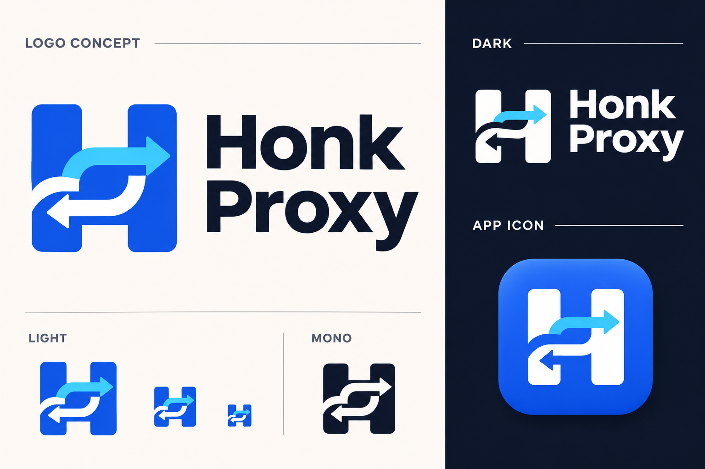

# Honk Proxy Logo 设计评审

- 关联任务：[#28](https://github.com/go-laoji/honk-proxy-server/issues/28)
- 分支：`feature/brand-logo-review`，使用 `git flow feature start brand-logo-review develop` 从 `develop` 创建。
- 独立 worktree：`/private/tmp/hps-brand-logo-review-20261102`。
- 状态：用户于 2026-11-03 明确确认蓝色 Logo，并接受第二版组合预览的 LIGHT 配色；正式资源、18 页与 Desktop 接入及 macOS 构建已完成。[实际验收与产物](validation/brand-assets-2026-11-03.md)。

## 第一版预览



预览文件：`docs/design/brand-logo-concept-v1.png`，1536 × 1024 PNG，使用内置 imagegen 生成。保留 H 的整体轮廓，以一对相反方向的弯曲箭头表达流量进出和转发；同时展示浅色、深色、单色与蓝色圆角应用图标。用户确认后已制作 SVG 母版，统一精确几何，并检查 16/24/32/48/64 像素用途。

初次评审检查了品牌拼写、H 与双向通路意象、深浅底适配和单色呈现。概念图的缩小示意与正式资源验收分开记录；确认后的正式 PNG、ICO、ICNS、单色模板与真实页面结果见最终验收。已安装应用始终未覆盖。

## Worktree 隔离记录

初始在原 managed worktree 从 `develop` 创建了 `feature/brand-logo`。生成预览期间，同一 checkout 被另一并发会话写入控制台配色提交 `8f1fdd7`。发现后保留原 checkout、分支与所有提交，另建上述独立 worktree，再从 `develop` 创建 `feature/brand-logo-review`，只 cherry-pick 两笔 Logo 设计提交。确认前分支仅有设计材料；确认后在该独立 worktree 交付正式资源，并通过 `904640f` 显式合并配色任务的最终 `5f17b53`，保留双方提交与历史。

## 设计方向

以 **H + 双向通路** 为核心：用两条简洁、互相咬合的路径构成 H，表达代理连接、转发与有序路由。主色 `#2563EB`，辅助色 `#38BDF8`；第一版评审图深色底 `#0F172A`，第二版统一界面方向改用午夜蓝 `#0B1220`。保持足够粗的轮廓与负空间，兼顾侧栏、浏览器标签、桌面应用及单色托盘用途。用户已否定松石青品牌主色，不向青绿色方案调整 Logo。

概念阶段先交付评审图，确认后从同一 SVG 母版导出几何一致的单色变体与各平台尺寸资源。概念图保留作历史设计依据，产品不引用 AI 评审截图。

## 执行步骤

1. [x] 检查实际 worktree、分支基点及原始未跟踪文件，创建 Issue 和功能分支。
2. [x] 使用内置 imagegen 生成概念评审图，检查文字、图形一致性与深浅色用途，新增保存到本设计目录。
3. [x] 提交提案材料并获得用户明确确认；确认前未修改产品图标。
4. [x] 用户确认后，制作确定性的 SVG 母版与单色托盘版本，统一下列产品入口。
5. [x] 验证所有页面、前端构建资源及 Tauri 图标打包；真实结果见最终验收，Issue 按最终证据回复关闭。

## 确认后的实施切片

1. 建立可重复导出的 SVG 母版及生成脚本，制作透明标志、深色/单色标志、应用图标与全套 Web/Tauri PNG/ICO/ICNS/托盘资源，检查大图与小尺寸后独立提交。
2. 接入共享导航、18 页 favicon 与 Tauri 托盘，保持无账号产品和系统网络保护边界，完成前端类型、格式及品牌资源检查后独立提交。
3. 只读核对并行任务的最终配色提交，通过明确提交同步组合效果；验证独立构建目录的 Web 与 macOS Tauri app，检查包内图标、资源哈希和真实页面，不覆盖已安装应用或原始 target。
4. 记录当前平台验证结果与产物位置，回复并关闭 #28。保持功能分支，不主动 push/finish；跨平台图标已生成不等于跨平台原生安装包已验收。

## 确认后的替换范围

| 位置 | 当前实现 | 确认后的工作 |
| --- | --- | --- |
| 共享导航与品牌 | `web/console/src/App.tsx` 中的 Lucide `Waypoints` 图形 | 统一使用确认后的标志与字标 |
| 浏览器标签 | `web/console` 的 18 个 HTML 入口当前没有 favicon | 所有入口引用统一 favicon，验证相对路径和构建资源 |
| Web / Desktop 共用产物 | `vite.config.ts` 构建并生成 `web-manifest.json`，Daemon 与 Tauri 共用 `dist` | 确保新资源进入构建与内容哈希 |
| Tauri 打包图标 | `src-tauri/tauri.conf.json` 引用 PNG、ICNS、ICO | 从同一母版生成所需尺寸，检查包内图标 |
| 桌面托盘 | `src-tauri/src/desktop.rs` 复用 `default_window_icon()` | 评估独立单色模板，验证实际图标引用 |

不更改应用名称、标识符或系统服务配置。原工作区 `/Users/jack/data/go-laoji/honk-proxy-server` 的原始未跟踪素材保持原样。

## 验证边界

提案阶段只检查设计文件和 Git 范围，不需要启动服务、编译 Desktop 或执行 Rust 测试。后续如需运行开发应用，必须设置 `HPS_FORBID_HOST_NETWORK_CHANGES=1`；不运行任何宿主网络配置写入验收，不覆盖已安装 Desktop bundle 或偏好。

## 概念图生成规格

使用内置 `image_gen` 工具；新图生成，无输入参考图，无 CLI/API 密钥路径。提示词如下：

```text
Use case: logo-brand
Asset type: a single polished brand concept review board for the existing Honk Proxy desktop application and web proxy control console.
Primary request: design one original, memorable logo, combining the capital letter H with two interlocking bidirectional routing paths. Use thick geometric strokes, restrained rounded corners, clear negative space, a compact balanced silhouette, and flat vector-like construction. The same exact logo must appear consistently in every application on the board. Make the H legible first; the routing meaning should be subtle. Keep the core mark simple enough to be reconstructed as clean SVG and readable at favicon size.
Scene/backdrop: sophisticated editorial brand presentation, landscape canvas, generous whitespace, warm off-white main background, a dark navy panel on the right, precise aligned grid. No photographic scene.
Composition/framing: large primary blue mark and the wordmark Honk Proxy on the upper left; below, a concise row of the same mark at small sizes and in monochrome; right, the same mark in white/light blue on dark navy, plus one premium macOS-style rounded square blue app icon with a white version of the same mark. The app tile can have subtle depth, but the logo itself must remain flat. Small sizes must be literal reductions of the large symbol, not alternate shapes.
Color palette: primary #2563EB, optional secondary #38BDF8, dark #0F172A, white. Match the existing blue/slate software console. Ensure the mark also works in one solid color; no gradient-dependent details.
Style/medium: refined professional software identity, clean optical balance, crisp edges, strong silhouette; no clip art, no stock icons, no shield, globe, padlock, bird mascot, node spaghetti, lightning bolt, or 3D ribbon.
Text (verbatim): Honk Proxy. Optional small labels only: LOGO CONCEPT, LIGHT, DARK, APP ICON, MONO. Do not add slogans, Chinese text, mock feature claims, or any other brand name.
Constraints: original design, one coherent proposal, consistent geometry across all repeated marks, high readability, no watermarks. This is a review board, not a production UI change.
```
