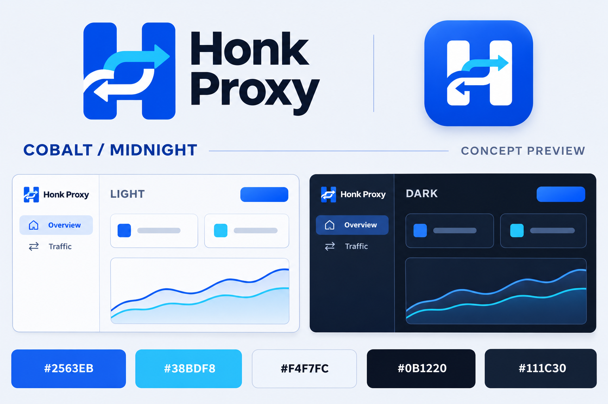

# Honk Proxy 冷蓝配色方向（第二版评审）

关联 Logo 任务 [#28](https://github.com/go-laoji/honk-proxy-server/issues/28) 与控制台配色任务 [#27](https://github.com/go-laoji/honk-proxy-server/issues/27)。

用户明确否定青绿色品牌方向，要求增强科技感，并授权通知正在并行执行的配色任务调整方向。已通过 Codex App 的 `send_message_to_thread` 将下列具体配色与范围同步给现有任务「规划 honk 代理服务」，继续复用其 `feature/console-color-motion`，不新建重复开发任务。



组合预览已生成并检查：品牌拼写正确、H 与双向通路意象保留、配色为蓝/青/冷白/午夜蓝，包含浅色和深色概念面板。其内的 UI 为概念示意，真实页面结果由 #27 单独验证。

## 统一配色

| 用途 | 颜色 | 使用方式 |
| --- | --- | --- |
| 品牌 / 主要操作 | `#2563EB` | 钴蓝；Logo、选中导航、主按钮 |
| 主要操作悬停 | `#1D4ED8` | 比主色更深的蓝色 |
| 辅助高亮 | `#38BDF8` | 少量图表、流量方向及标志细节 |
| 浅色页面 | `#F4F7FC` | 冷白与银灰，搭配白色卡片 |
| 深色页面 | `#0B1220` | 午夜蓝 |
| 深色卡片 | `#111C30` | 与页面形成轻微层次 |
| 深色边界 | `#24334D` | 精确可辨的卡片与输入边线 |
| 深色交互强调 | `#60A5FA` | 保持深色底上的可读性，由前端任务实际测量对比 |

H + 双向通路造型继续沿用第一版蓝色 Logo 的方向。取消将品牌改为松石青的建议；绿色只保留为小面积成功语义色。科技感通过蓝色层次、清晰边界和少量高亮呈现，不增加满屏霓虹、持续发光或装饰性循环动画。

## 分工与确认边界

- 控制台任务在其独立工作区调整共享主题、保留已有图标动效和 `prefers-reduced-motion`，完成浅/深色检查、前端构建和相关浏览器验证，并更新 #27 的真实结果。
- 本分支 `feature/brand-logo-review` 在评审阶段只新增设计材料；用户于 2026-11-03 确认后已制作正式资源并接入产品。原始概念图保留。
- 组合概念图为 AI 生成的设计示意，不能作为真实应用截图、运行状态或构建验收证据。
- Logo 与 LIGHT 配色已获用户确认，正式 SVG、图标导出、18 页 favicon、Tauri 应用与托盘接入以及独立 macOS 包验收已完成，见[最终验收](validation/brand-assets-2026-11-03.md)。已安装 bundle 未覆盖。
- 不跨 worktree 写入，不主动 push/finish，不修改宿主网络；如运行开发应用，继续设置 `HPS_FORBID_HOST_NETWORK_CHANGES=1`。

## 第二版组合预览生成规格

工具：内置 `image_gen`；编辑参考：`docs/design/brand-logo-concept-v1.png`，用于保留既有 Logo 造型。输出新增保存为 `docs/design/brand-visual-direction-v2.png`，1536 × 1024 PNG，已生成并检查。

```text
Use case: logo-brand / identity-preserve
Asset type: one landscape art-direction review board showing the existing Honk Proxy logo paired with a coherent new software color theme.
Input image 1: identity reference and edit target for the logo. Preserve the distinctive H silhouette and its opposing curved routing arrows exactly. Keep the original blue/cyan/white identity; do not turn the mark green or redesign it.
Primary request: replace the previous board layout with a refined cobalt-blue and midnight-blue visual direction. The user rejected teal and wants a more technological, precise software aesthetic that stays restrained.
Composition: generous margins and a precise editorial grid. Top left, the reference H logo with the exact wordmark Honk Proxy. Top right, a premium rounded-square cobalt app icon using the same white H and small cyan upper-arrow detail. In the lower half, two equal-sized compact UI concept panels side by side: a cold-white light console and a midnight-blue dark console. Each has a simple narrow sidebar, a selected navigation row, a primary blue action, two sparse data cards, and a clean blue/cyan line-chart placeholder without numeric metrics. Give the panels enough space to judge surfaces, contrast, and accent colors. Along the bottom, five clean labeled color chips.
Color palette: primary #2563EB, hover/deeper blue #1D4ED8, restrained highlight #38BDF8. Light page #F4F7FC with white surfaces and blue-gray borders. Dark page #0B1220, dark cards #111C30, dark borders #24334D, light-blue interaction accent #60A5FA. Off-white or cool-gray board backdrop. The five color chips must be labeled exactly #2563EB, #38BDF8, #F4F7FC, #0B1220, #111C30 and visually match those colors.
Text verbatim: Honk Proxy, COBALT / MIDNIGHT, CONCEPT PREVIEW, LIGHT, DARK. Use only minimal English UI labels Overview and Traffic if needed. No Chinese, no invented slogans, no numeric fake operational metrics.
Style: professional developer/networking software identity, crisp flat logo, subtle UI depth, sharp typography, calm spacing, strong hierarchy. Blue must feel confident and clean, not gray or washed out. Cyan is a small secondary accent, never a large teal/green surface.
Constraints: preserve the same H/arrow geometry in all logo instances; no teal, jade, mint, or green brand surfaces; no neon glow, cyberpunk grids, excessive gradients, photography, watermark, or logo redesign. UI panels are clearly design concepts, not evidence of running software. Keep the original logo's legibility and balance.
```
