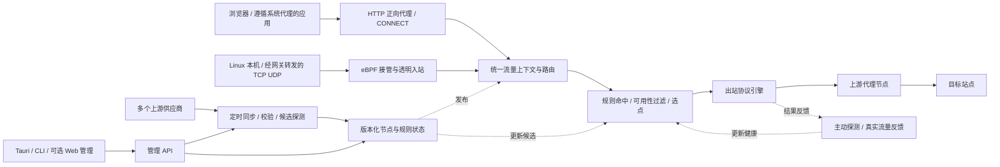

# honk-proxy-server 整体规划与可行性分析

- 文档日期：2026-11-01（Asia/Shanghai）。
- 对应任务：[Issue #1：规划代理池服务架构与 Linux eBPF 可行性](https://github.com/go-laoji/honk-proxy-server/issues/1)。
- 当前状态：调研与设计建议，尚未实现或验证代理功能。
- 上游核查基线：`daeuniverse/honk` 的 `54b2e1cfbe1e7f8a93dba3a0f64fabf2a9f88e38`，后文上游源码链接均固定到该提交。
- 本地现状：Tauri 2 + React 19 + TypeScript + Rust 模板；Rust 入口只有示例 `greet` 命令，没有代理、节点池、同步或 eBPF 实现。已有模板文件在本次调研开始时均未被 Git 跟踪，本次仅新增本文档。

## 1. 结论与产品边界

需求可实现。建议定位为“统一代理入口 + 多供应商节点池 + 规则与健康调度 + Linux eBPF 透明代理”的常驻服务，现有 Tauri 项目作为桌面管理端。

浏览器只需要配置一个稳定地址，例如 `127.0.0.1:7890`，服务在每次新建目标连接时，从符合规则且可用的上游节点中选择一个出口。上游增删和健康变化不要求用户修改浏览器配置。

Linux 必须提供真实 eBPF 透明接管能力，覆盖配置范围内的本机和局域网 TCP/UDP；同时保留显式 HTTP 代理入口。eBPF 支持必须成为 Linux 版本发布条件，不能以 mock、开关、监控功能或普通 HTTP 监听代替。

实现中需要明确以下边界：

1. **HTTP 代理和 eBPF 是两个流量入口。** 浏览器显式代理不需要经过 eBPF 才能工作；Linux 透明接管负责未设置代理、但经过指定主机/网关的流量。两种入口共享节点、规则与调度状态。
2. **系统代理设置不等于所有程序流量被接管。** 是否使用系统 HTTP 代理取决于应用；UDP、QUIC 和自行联网的应用需要透明接管或其他专门支持。
3. **远程代理服务器的 eBPF 不会自动接管用户电脑的全部流量。** eBPF 只作用于该 Linux 主机和经过它的流量；远端客户端仍需显式代理、网关路由或未来单独规划的隧道。
4. **HTTPS 默认使用 CONNECT 隧道。** TLS 保持端到端；不安装根证书，不进行中间人解密。可按 CONNECT 中的目标主机和端口匹配规则，无法读取隧道内的完整 URL、请求正文或 Cookie。[CONNECT 语义](https://www.rfc-editor.org/rfc/rfc9110.html#section-9.3.6)
5. **节点故障后的切换主要针对新连接。** 已建立的 TCP、WebSocket、TLS 或 UDP 会话通常不能迁移到另一出口；客户端需要重连。不能把“自动切换”描述为所有长连接无感迁移。
6. **可用性有作用范围。** 节点端口可连接，不代表能完成代理鉴权，更不代表能访问任意目标；TCP、UDP、IPv4、IPv6、特定目标的可用性需要区分。

## 2. honk 的现有能力与复用缺口

### 2.1 已核实的上游能力

| 领域 | 当前上游情况 | 对本项目的意义 |
| --- | --- | --- |
| 技术栈 | Rust 工作区，包含 config、outbound、core、eBPF 公共类型及独立 eBPF crate | 与当前 Tauri Rust 后端相近，可优先采用 Rust 服务进程 |
| Linux 数据面 | TC/TCX、cgroup、`sk_lookup`、`dae0`/`daens` 及用户态转发 | 可复用透明接管基础，无需从零编写整套网络栈 |
| 出站协议 | SOCKS5、SS、Trojan、AnyTLS、Hy2、TUIC 等；VMess/VLESS 受构建特性约束 | 可复用协议实现；必须按实际构建产物公布协议矩阵 |
| 分组策略 | Selector、URLTest、LoadBalance、Fallback、Score | 大部分基础选点和健康能力已有实现 |
| 订阅 | 多订阅源、格式识别、定时刷新、缓存、失败退避、保留旧节点 | 供应商中的标准订阅类型可以复用，不必重复实现全部逻辑 |
| DNS | 多种上游、路由与缓存 | 可以作为透明域名路由和引导解析的基础 |
| 管理 | Native API、Clash API、状态及配置相关接口 | 可参考和适配，但管理 HTTP API 本身不是 HTTP 正向代理端口 |

依据：[工作区定义](https://github.com/daeuniverse/honk/blob/54b2e1cfbe1e7f8a93dba3a0f64fabf2a9f88e38/Cargo.toml)、[数据面设计](https://github.com/daeuniverse/honk/blob/54b2e1cfbe1e7f8a93dba3a0f64fabf2a9f88e38/doc/en/design/datapath.md)、[分组与健康设计](https://github.com/daeuniverse/honk/blob/54b2e1cfbe1e7f8a93dba3a0f64fabf2a9f88e38/doc/en/design/groups.md)、[订阅参考](https://github.com/daeuniverse/honk/blob/54b2e1cfbe1e7f8a93dba3a0f64fabf2a9f88e38/doc/en/reference/subscription.md)。

### 2.2 不能直接假定已经具备的能力

| 缺口或限制 | 核查结果与处理建议 |
| --- | --- |
| 浏览器使用的 HTTP/CONNECT 入站 | 上游 README 仍将入站支持列入 TODO；本项目必须补齐，不能把 Clash/Native API 当成代理入口 |
| HTTP/HTTPS 上游代理 | 当前出站协议描述表没有通用 HTTP/HTTPS 代理类型；若供应商提供此类节点，需要增加 CONNECT 出站及对应导入、健康和鉴权处理 |
| 商业供应商 API | 标准订阅不等于购买、按次提取、短时有效 IP、动态凭据、配额和 IP 白名单；这些需要供应商适配器 |
| 跨平台服务 | 上游透明数据面仅支持 Linux；不能直接承诺 `honk-core` 在 macOS/Windows 可编译运行 |
| 稳定集成接口 | 已有公开 Rust 模块不等于长期稳定的嵌入式 SDK；需验证初始化、运行代际、退出与状态注入边界 |
| 生产成熟度 | 上游仍将项目标为实验性 alpha，需要固定版本、回归和灰度验证 |
| 开源许可 | 上游标识为 `GPL-3.0-only`；选择直接集成或维护修改版前，应按项目预期分发方式确定许可方案 |

依据：[上游 README](https://github.com/daeuniverse/honk/blob/54b2e1cfbe1e7f8a93dba3a0f64fabf2a9f88e38/README.md)、[出站协议描述表](https://github.com/daeuniverse/honk/blob/54b2e1cfbe1e7f8a93dba3a0f64fabf2a9f88e38/crates/honk-outbound/src/descriptor.rs)、[出站 crate](https://github.com/daeuniverse/honk/blob/54b2e1cfbe1e7f8a93dba3a0f64fabf2a9f88e38/crates/honk-outbound/Cargo.toml)。上述跨平台与集成建议属于基于源码结构的工程判断，尚未通过本项目构建证明。

## 3. 推荐总体架构

采用“独立服务进程 + 共享流量引擎 + 可选桌面管理端”。服务能在无桌面 Linux 上独立运行，关闭 Tauri 窗口不应关闭系统代理服务。



图中供应商同步和健康检查是后台任务，不是每个浏览器请求都必须串行经过的步骤。请求路径使用已经发布的内存快照，避免实时查询供应商和数据库。

### 3.1 职责划分

| 模块 | 主要职责 |
| --- | --- |
| `hpsd` 服务进程 | 生命周期、配置加载、代理入口、管理接口、后台任务、退出与重启 |
| 显式代理入口 | HTTP absolute-form 请求、CONNECT、鉴权、目标解析、流式转发 |
| Linux 引擎适配层 | honk eBPF 生命周期、透明 TCP/UDP 入站、原始目标和本机进程信息 |
| 共享流量运行时 | 统一上下文、规则、分组、拨号、连接固定、反馈、代际发布 |
| 供应商适配器 | 订阅/API 抓取、格式标准化、增量合并、到期和配额信息 |
| 状态与配置 | 持久配置、发布版本、上次成功快照、恢复和变更记录 |
| 管理端 | 概览、供应商、节点、组、规则、连接、Linux 接管状态、设置 |

### 3.2 统一运行时是核心约束

每条流量标准化为 `FlowContext`：入口类型、客户端身份/源地址、目标域名或 IP、端口、TCP/UDP、地址族、可获取的本机进程信息及规则版本。

一次决策得到 `RouteDecision`：命中规则、组或固定节点、允许的回退范围、会话固定方式和失败原因。显式入口和透明入口必须使用同一套规则语义。

Linux 实现优先在固定版本的 honk 集成层中增加显式 HTTP/CONNECT 入口，使其调用同一个 Router、GroupManager、健康和出站运行时。将这一共享边界整理成项目维护的接口；是否能直接依赖现有 crate，还是需要小范围 fork，由 P0 验证决定。

不采用“一个 HTTP 服务自行选点，另一个 honk 进程又独立选点”的双重调度。Native/Clash API 可用于控制，但不能替代实际拨号接口。如果未来采用 sidecar，必须提供明确的转发接口和单一规则/状态归属；普通配置下发加管理 API 不足以完成该集成。

## 4. 入口、协议和连接语义

### 4.1 面向用户的运行方式

| 模式 | 使用方式 | 能力与限制 |
| --- | --- | --- |
| 显式代理 | 浏览器或系统填写服务地址和端口 | HTTP 与 HTTPS CONNECT；应用需要支持相应代理设置 |
| Linux 本机透明 | 启用本机接管范围 | 配置范围内 TCP/UDP；需要 eBPF、路由和 DNS 配合 |
| Linux 网关透明 | 客户端流量经过该网关 | 局域网转发流量；路由拓扑必须实际经过服务节点 |
| macOS/Windows 桌面 | 初期连接远端 Linux 服务；本地显式代理由 P0 单独验证 | 不承诺复用 Linux eBPF；全局透明接管另立平台项目 |

首个 Linux 功能版本同时包含显式 HTTP/CONNECT 和真实 eBPF。SOCKS5 入站可后续增加，不阻塞第一阶段；SOCKS5 出站则可作为最早验证节点。

### 4.2 HTTP 入口实现要求

- HTTP/1.1 正向代理支持标准代理请求格式、流式上传下载、Keep-Alive；每个目标请求独立执行授权和规则匹配。
- CONNECT 解析 `host:port` 和 IPv6 authority；上游隧道建立成功后才返回成功响应，并处理缓冲区中已读取的后续数据。
- CONNECT 成功后双向转发、支持半关闭、超时与取消，不解析或重放隧道内业务请求。
- 代理鉴权与管理鉴权分离；正确区分 407、规则拒绝、无可用节点、拨号失败和超时。
- 普通 HTTP 转发正确处理 hop-by-hop 头、请求目标和消息边界；不把本地 `Proxy-Authorization` 传到目标站点。
- 上游连接复用按节点、目标、协议、身份与运行代际隔离，避免跨用户或跨节点错误复用。
- 以经过验证的 HTTP 协议库处理解析和流式消息，不自行拼接不完整的 HTTP 解析器。

重试仅默认发生在目标业务数据尚未发送、且策略允许切换的拨号/上游握手阶段。已经传输业务数据的连接返回错误并由客户端决定重连；代理不得自动重试非幂等请求。[HTTP 重试约束](https://www.rfc-editor.org/rfc/rfc9110.html#section-9.2.2)

### 4.3 上游协议范围

初期优先 SOCKS5 与 HTTP/HTTPS 代理出站，覆盖常见代理供应商；再按真实订阅需要开放 SS、Trojan、VLESS 等已核实协议。

“HTTPS 上游代理”指客户端到代理服务器之间使用 TLS，与“通过 HTTP 代理 CONNECT 访问 HTTPS 目标”是两个概念。HTTPS 上游要验证代理服务器证书；上游 407 或供应商权限拒绝不应被无限重试。

HTTP CONNECT 上游通常不能承载普通 UDP，而且可能只允许部分目标端口。节点能力须记录 UDP、地址族、端口和供应商限制，不能把所有节点放入同一个无差别 TCP/UDP 候选集合。若供应商只支持普通 HTTP 转发而不支持所需 CONNECT，则需专门的转发适配或明确拒绝该用途。

## 5. 多供应商同步与节点生命周期

### 5.1 供应商类型

1. 静态配置：手工添加节点、批量文本导入。
2. 标准订阅：URI 列表、Base64 列表、Clash、sing-box 等实际可验证格式。
3. 供应商 API：JSON、分页、令牌、按需提取、节点有效期、IP 白名单及配额。

供应商是节点来源，节点组是可用于选点的集合；一个组可以包含多个供应商，一个节点也可以属于多个组。

### 5.2 同步流程

```text
定时/手动触发
  → 按供应商加锁、受限并发抓取
  → 检查响应、大小、格式、过期时间与字段
  → 标准化并生成候选版本
  → 身份去重、计算新增/更新/移除
  → 候选节点基本验证与探测
  → 生成完整可发布快照
  → 发布到共享运行时并记录实际激活版本
  → 被移除节点停止接新连接，已有连接排空
```

要求：

- 每个供应商可配置同步间隔、超时、重试上限、随机抖动、来源格式和抓取出口；遇到 429 尊重限流并退避。
- 标准订阅复用 honk 现有解析与刷新能力；项目调度器只负责额外适配或通过统一调度接口调用，不能同时启动两套定时器抓同一个源。
- 空响应、鉴权失败、解析失败或少量损坏不能直接清空线上池。异常大幅缩减先进入待检查状态；明确授权的空快照另有操作语义。
- 保留上一份成功快照，但到期、撤销凭据、失效租约不能因缓存而继续作为有效候选。
- 短效节点提前刷新，预留握手与会话时间；设置最大陈旧时间，避免供应商长期故障时无限沿用旧节点。
- 启动先恢复未过期的成功快照，再异步刷新；无有效节点时默认拒绝流量，不隐式直连。
- 第一次同步须有独立的 bootstrap 路径。不能要求一个尚未建立的代理池下载它自己的唯一订阅。
- 并发同步结果携带版本号，过期任务不能覆盖更新版本；供应商抓取、数据库激活记录和运行时发布需要可恢复的状态机。
- 用户态快照与 eBPF 规则/组映射使用同一代际标识；发布失败保留旧版本，进程重启时对齐持久记录与实际激活版本。

标准订阅的保留旧节点、缓存和刷新机制可参考上游；本项目增加的供应商/API 生命周期与版本发布不能假定已被上游完整覆盖。[订阅机制与边界](https://github.com/daeuniverse/honk/blob/54b2e1cfbe1e7f8a93dba3a0f64fabf2a9f88e38/doc/en/reference/subscription.md)

### 5.3 身份与归属

建议使用本项目稳定的内部 ID，独立映射上游运行时 ID。指纹涵盖协议、地址、端口、鉴权材料、TLS 与影响连接行为的参数，不能仅以节点名称判断同一节点。

去重保留来源关系：同一个节点被多个供应商提供，删除某一来源不能误删其他来源仍然有效的记录。动态用户名中的 session、地域和租约参数属于连接身份；凭据变化须生成新版本并排空旧运行时。指纹不公开，不输出可用于猜测凭据的原始材料。

建议将“管理状态”和“健康状态”分开：管理状态包括启用、禁用、到期、排空、移除；健康状态包括未知、验证中、健康、降级、不可用。到期与禁用优先于健康结果。

## 6. 健康检查与自动选点

### 6.1 健康检查

| 检查层次 | 判断内容 | 使用方法 |
| --- | --- | --- |
| 地址与端口 | DNS、TCP/QUIC 初始可达 | 快速筛除明显故障，不能独立判为业务可用 |
| 代理握手 | 协议协商、认证、CONNECT/SOCKS 等 | 识别账号过期、权限不足或协议不兼容 |
| 穿透访问 | 通过该节点访问受控测试目标 | 记录状态码、握手、首字节耗时和结果 |
| 实际连接反馈 | 真实拨号、超时、连接中断 | 更新相关节点/目标/网络维度的统计 |
| 能力验证 | UDP、IPv4/IPv6、出口信息等 | 按能力或显式诊断需求执行 |

以受控且获准的探测目标为主，采用多目标或分组探测，避免单个站点故障导致全池被误判。对 403、429、目标主动拒绝和本地资源不足分类，不能全部记成节点全局死亡。

建议初始参数：活跃节点 30–60 秒一轮、3–5 秒单次超时、全局探测并发 10–20；故障节点指数退避，连续成功后恢复。以上是待压测调优的产品初值，不是对上游当前默认值的描述。

所有入口复用同一健康来源；先采用上游已有健康模型，按供应商语义补充，而不是对相同节点启动两套互相矛盾的检测器。健康记录至少区分 TCP/UDP 与 IPv4/IPv6；采样规模由探测预算控制。

探测开销可估算为 `节点数 × 每轮探测目标数 ÷ 周期间隔` 次/秒。例如 1,000 个节点、每轮一个目标、60 秒周期，约 16.7 次/秒，尚未计入 DNS、失败重试和 UDP 检查。大量短效节点应优先探测候选和活跃节点，避免检测费用超过业务流量。

### 6.2 选点策略

首版支持：固定节点、顺序故障切换、延迟优选、轮询或加权负载均衡、带有效期的会话固定。优先复用 honk 现有策略；高级 Score 与自定义复杂评分在有真实数据后再评估。

决策顺序固定为：

1. 入口访问控制和协议/目标限制。
2. 按优先级匹配用户规则，得到节点或组。
3. 排除禁用、到期、不具备所需能力和超出配额/并发限制的节点。
4. 按相应健康维度筛选，并根据策略选点。
5. 建连并固定当前连接；仅在允许的建连阶段及回退范围内尝试其他候选。
6. 将结果反馈到对应范围的统计。

用户固定某个节点时，默认失败即返回错误。只有规则明确允许回退，才可以在指定候选范围内切换；不越过地域、供应商或出口身份限制。全组不可用时默认拒绝，直连必须是用户明确的规则动作。

黏性建议按“客户端身份/配置档 + 目标域名或业务分组”设置 TTL，并允许服务端生成固定会话键；HTTP 代理无法读取 HTTPS 内的 Cookie 作为黏性依据。上游若是供应商的统一旋转入口，本地固定同一个入口也不保证固定出口 IP，必须结合供应商 session 能力。

## 7. 用户规则与 DNS

### 7.1 首版规则能力

支持域名精确/后缀、目标 CIDR、目标端口、TCP/UDP、客户端源 CIDR、代理用户或入口标签；动作包括固定节点、节点组、明确直连和拒绝。

Linux 本机透明模式可以增加进程名等可获取条件。经网关转发的客户端进程身份不可见；远程 HTTP 入口也不能从连接中获得远端浏览器进程名。上游当前进程名还有长度和获取回退限制，不能宣传为稳定的完整可执行路径匹配。[路由参考](https://github.com/daeuniverse/honk/blob/54b2e1cfbe1e7f8a93dba3a0f64fabf2a9f88e38/doc/en/reference/routing.md)

采用“优先级明确、首条匹配生效、最后一条默认动作”的产品语义，并确保向上游路由模型的编译结果一致。规则发布前检查未知组、冲突、循环嵌套和不可实现的匹配条件。增加规则模拟：输入入口、用户、目标和协议，显示命中规则与候选范围；涉及实时健康时标明模拟时刻。

例如：工作站用户访问 `*.example.com` 进入香港组；测试任务访问指定 API 固定某供应商；默认进入自动组；自动组全部不可用则失败。这些是建议的产品语义，尚不是可直接运行的 honk 配置文件。

### 7.2 DNS 设计

- 显式 CONNECT 优先使用其目标主机名，避免过早解析为 IP 导致域名规则失效；根据协议和策略决定远端解析或本地受控解析。
- Linux 透明模式使用被接管的 DNS 查询与缓存关联域名/IP，并在需要时结合可见的 TLS SNI、HTTP Host 等线索。
- DNS 缓存按解析策略和必要的出口维度隔离，避免把一个出口获得的结果错误用于另一个出口。
- 代理节点主机名、订阅和 DNS 上游要有独立引导解析与防回环路径；split DNS、IPv6 和缓存过期都进入测试范围。
- ECH、外部加密 DNS、硬编码 IP、共享 CDN IP 等会影响透明域名识别，无法保证每条连接都恢复原域名；无域名时使用明确的 IP/默认规则。
- 首版不增加 FakeIP 引擎；上游当前也没有 FakeIP，若后续确有需求另做兼容性设计。[架构范围](https://github.com/daeuniverse/honk/blob/54b2e1cfbe1e7f8a93dba3a0f64fabf2a9f88e38/doc/en/design/overview.md)

## 8. Linux eBPF 专项方案与发布门槛

### 8.1 实现路径

沿用 honk 的 TC/TCX 分类与重定向、cgroup 身份记录、隔离网络命名空间、透明监听和用户态转发。eBPF 负责适合内核完成的分类、连接映射、快速直连和重定向；认证、复杂规则补充、代理协议握手、TLS 和供应商请求在用户态执行。

不把协议握手和完整代理客户端塞入 eBPF；不把全部代理流量宣传为内核转发。加密、跨出口连接和慢路径仍有用户态成本。首版不自行扩展 XDP/AF_XDP，以减少正确性和维护范围。[数据面职责](https://github.com/daeuniverse/honk/blob/54b2e1cfbe1e7f8a93dba3a0f64fabf2a9f88e38/doc/en/design/datapath.md)

### 8.2 环境要求

采用本次核查的 honk 数据面时，支持基线为 **Linux 6.12+**。这是该上游实现的要求，不是所有 eBPF 软件的通用最低版本。

启动预检至少检查：

- 当前内核版本和必需 BPF、TCX、网络命名空间等功能。
- cgroup v2 及必需的 socket/cgroup hooks，尤其所需 `sock_ops` 是否可挂载。
- 可用的 BTF 文件、bpffs、资源和文件描述符限制。
- 网络接口、默认路由、IPv4/IPv6、DNS 及管理通路。
- 若启用相应 UDP 首包处理，检查上游所需 NFQUEUE/nftables 功能。
- 现有 dae/honk、其他 TC/cgroup 程序及防火墙是否冲突。

按上游当前说明，真实数据面以 root 运行。第一阶段采用受控系统服务，管理 UI 保持普通用户；更细权限拆分在验证完整生命周期后再实施，不能先承诺简单几个 capability 就完全等价。

上游还明确指出：普通 `cargo build --release` 不会开启真实数据面，需构建独立 eBPF 对象并启用相应特性；mock 模式不拦截流量。发行包要能验证内嵌 eBPF 对象，不能只验证程序能启动。[启动与构建要求](https://github.com/daeuniverse/honk/blob/54b2e1cfbe1e7f8a93dba3a0f64fabf2a9f88e38/doc/en/how-to-start.md)

### 8.3 生命周期与防回环

1. 代理出站、供应商下载、探测和 DNS 上游使用受控 bypass 标记或相应排除机制，防止服务把自己的连接再次接管。
2. 显式代理和透明代理同时开启时，显式代理出站不被二次选点；管理端和本地控制连接有清晰的排除范围。
3. 记录本实例拥有的 hooks、maps、命名空间与配置改动；停止时只清理自己创建的资源，不删除其他网络软件的对象。
4. 热更新使用上游的代际与发布机制，避免用户态规则和内核组映射错位；旧连接按定义排空。
5. 处理网卡变化、默认路由切换、系统休眠恢复、VPN 并用和服务异常退出。
6. eBPF 模式请求失败必须可见，不能静默退成普通 HTTP 模式并显示“透明接管正常”。
7. 明确区分“服务正常拒绝不可用出口”与“服务进程崩溃后的系统行为”。崩溃时 hooks 脱离可能恢复原生直连；若产品要求崩溃也不得直连，需要额外、可恢复的防火墙/kill switch 设计并独立验收，不能仅靠用户态 fail-closed 承诺。

### 8.4 验证与发布条件

- 使用真实 Linux VM 或物理机；分别验证 x86_64、aarch64，至少覆盖 6.12 LTS 和另一实际部署内核。
- 在安装后的发行二进制上证明 hooks 与 maps 存在、计数变化、真实流量被接管；同时用目标端观测出口验证路由。
- 分别测试本机 TCP、LAN TCP、本机 UDP、LAN UDP、DNS、IPv4 与 IPv6。
- 把 SOCKS5/其他 UDP 可用节点与 HTTP TCP-only 节点混合，确认 UDP 不被送入不支持的出口。
- 测试显式入口与透明入口同时运行，使用相同规则时决策一致，且没有循环或重复计费。
- 测试重载、节点移除、断网恢复、网卡热变更、异常退出与重新启动，并验证管理通道仍可恢复。
- 对当前上游未支持或未承诺的拓扑单列限制；例如单臂旁路由不作为首版默认支持拓扑。

当前开发主机为 macOS，本次只完成源码和文档核查，没有执行上述 Linux 测试。任何 mock、单测或 macOS 构建结果都不能替代这些验收。

## 9. 持久化、管理接口与管理端

### 9.1 持久化建议

首版按单实例部署设计，采用 SQLite 保存配置、来源关系、同步记录、规则版本和激活状态；热路径使用内存快照。避免同时引入 MySQL、Redis 与分布式调度。若复用 honk 自身状态库，明确表和迁移归属，通过接口集成，不能直接依赖其私有表布局。

| 实体 | 关键内容 |
| --- | --- |
| Provider | 类型、名称、启停、调度、抓取路径、凭据引用、上次成功和错误 |
| NodeVersion | 稳定身份、协议/地址/能力、凭据引用、有效期、当前版本 |
| ProviderNode | 来源归属、供应商节点 ID、租约和同步版本 |
| NodeGroup / GroupMember | 候选过滤、静态成员、策略、黏性与回退范围 |
| RouteRule | 顺序、匹配条件、动作、所引用的节点/组与配置版本 |
| ClientProfile | 代理身份、入口权限、并发/带宽限制和会话配置 |
| SyncRun / ConfigRevision | 抓取和发布结果、版本、错误分类及回滚信息 |

高频连接指标、健康滑动窗口和活跃会话不逐包写数据库；采用有界内存、批量聚合和可配置保留期。

### 9.2 接口范围

管理 API 至少覆盖：服务版本与能力、供应商 CRUD/手动同步、节点检索/探测/启停、分组策略、规则 CRUD/排序/模拟、配置校验/激活/回滚、连接列表与主动断开、指标与事件、Linux 预检与接管状态。

接口返回 `configured_revision`、`active_revision` 与激活错误，避免“配置已保存”被误认为“数据面已生效”。实时事件采用 SSE 或 WebSocket；代理端口与管理端口独立。若复用 Native/Clash API，使用适配层并核对上游版本，不承诺现有 UI 与任意上游版本直接兼容。

### 9.3 管理界面

保留现有 React + Tauri 作为桌面壳，通过同一个 API 管理本地或远端服务。首版页面：

- 概览：入口、有效节点、连接数、吞吐、同步异常、eBPF 实际状态。
- 供应商：来源类型、定时计划、节点数、最近同步和错误。
- 节点：筛选、所属来源、能力、有效期、健康、延迟和手动探测。
- 分组：成员、选点策略、当前选择、回退和黏性。
- 规则：顺序、匹配、动作、模拟和命中统计。
- 连接与事件：选中节点、命中规则、失败原因和有限保留的事件。
- 设置与 Linux 诊断：监听、鉴权、DNS、接管范围、环境预检和恢复状态。

不要让 Tauri 以 root 身份运行整个桌面界面。桌面“启用服务”调用受控安装/系统服务流程；其具体授权体验在实现阶段按操作系统设计。

## 10. 安全、运维与容量

- 默认仅监听 loopback。局域网或远程使用须配置明确的来源限制与代理身份；远程入口通过 TLS 或可信网络保护。
- 代理用户、管理用户、供应商凭据相互独立；凭据在响应、日志、错误、导出中脱敏，数据库和备份设置最小访问权限。
- 供应商 URL 是服务端抓取入口：限制协议、重定向、响应大小、连接超时，并检查每次解析和重定向的实际连接地址；私网源仅在显式配置后允许，避免仅检查 URL 字面量而遗漏 DNS 重绑定。
- 对访问本机、云元数据和内网服务的代理目标设置明确策略；网关内网直连可显式配置，不能与远程开放代理的默认权限混为一谈。
- 限制连接数、拨号并发、探测并发、供应商请求和缓冲区大小；通过流式转发与背压避免大文件占满内存。
- 默认日志记录时间、身份、目标主机/端口、规则、节点、错误和耗时；不记录 HTTPS 内容、凭据或带令牌的完整 URL。
- 提供存活/就绪状态、结构化日志、指标与有界事件；服务活着但没有可用出口、eBPF 挂载失败等应单独体现。
- Linux 优先 systemd 原生部署；容器透明模式需专门验证宿主网络、cgroup/BPF 权限与命名空间边界，普通无特权 Docker 不是默认支持方式。
- 升级固定 honk commit/tag 与工具链、生成第三方依赖及许可清单，验证迁移和回滚；不能跟随 main 自动更新线上引擎。

容量首先关注并发连接、文件描述符、内存缓冲、上下游带宽、协议 CPU、UDP 状态和探测费用。经过服务的数据都会占用相应方向的网络资源；eBPF 并不消除加密和上游限速。是否需要多实例应由压测和部署目标决定。

初期压测建议覆盖 100/1,000/10,000 节点、100/1,000/5,000 并发连接以及短连接、长下载、WebSocket、UDP 混合流量。记录实际硬件、协议、CPU/RSS、吞吐、错误率和连接延迟分位数；这些是测试档位，不是当前性能承诺。吞吐测试和大规模探测使用自有或获准环境。

## 11. 技术路线比较与建议

| 路线 | 优点 | 成本与结论 |
| --- | --- | --- |
| 固定版本 honk + 小范围集成/必要 fork + Rust daemon | 保留 eBPF 和现有出站、健康、规则基础；与当前 Rust 工程接近 | 推荐作为 P0 验证路线；需要补显式入站、HTTP 出站、供应商和管理产品能力 |
| 纯配置包装 honk 二进制 | 可较快管理原有透明代理与标准订阅 | 单靠现有管理 API 不能满足浏览器显式 HTTP 入口，不能视作完整交付 |
| 自研全部代理协议与 eBPF | 边界自主 | 工作量与网络正确性风险高，不建议首版采用 |
| 另选显式代理核心并并行运行 honk | 可能缩短显式代理原型时间 | 必须解决双引擎的规则、健康、出口和回环一致性；仅作为 P0 复用失败后的备选 |
| Go/Kratos 控制面 + Rust 网络服务 | 适合已有大量 Go 平台集成的团队 | 当前仓库无此基础；会增加部署、IPC 与双运行时维护，不作为默认起点 |

建议初期以 Rust + Tokio 为常驻服务基础，按当前上游已使用的 HTTP 生态评估显式入口与管理接口；UI 延续当前 React/Tauri。具体库、接口和依赖版本在 P0 构建验证后锁定。本次不引入新依赖或调整现有模板。

建议的逻辑目录为 `crates/daemon`、`crates/runtime`、`crates/http-inbound`、`crates/provider`、`crates/state`、`crates/engine-honk`，现有 `src` 和 `src-tauri` 保留为管理端；具体是否拆成这些 crate 由最小原型决定，避免一开始就切得过细。

## 12. 分阶段交付与验收

以下按一位熟悉 Rust/Linux 网络的开发者、供应商数量有限、先单实例估算，整体约 **8–14 人周**。这是规划区间；供应商协议、跨平台范围、上游接口变动和 Linux 环境准备会显著影响结果，不作为交付日期承诺。

| 阶段 | 工作内容 | 验收结果 | 粗估 |
| --- | --- | --- | --- |
| P0 技术验证 | 固定 honk 基线；验证共享 Router/出站集成；最小 CONNECT；真实 Linux eBPF；验证 macOS/Windows 用户态边界 | 浏览器和透明流量通过同一 SOCKS5 测试节点到目标；有真实出口、hooks、失败恢复证据；形成集成决策记录 | 1–2 周 |
| P1 代理运行时 | HTTP/CONNECT、HTTP(S)/SOCKS5 出站、鉴权、分组、拨号失败处理、连接固定、流式转发 | HTTP/HTTPS、IPv6 authority、大文件、半关闭和隔离正确；无业务请求误重放 | 1–2 周 |
| P2 节点与供应商 | 标准订阅、一个真实供应商 API、持久化、同步、到期、探测、健康和回退 | 两个来源自动同步；错误不清池；到期不继续选用；重启恢复 | 1–2 周 |
| P3 Linux 产品化 | TCP/UDP、DNS、防回环、原子发布、预检、systemd、生命周期和诊断 | 通过第 8 节真实环境验收；不满足条件的环境明确拒绝透明模式 | 2–3 周 |
| P4 管理端 | 管理 API、Tauri 页面、规则模拟、事件和远端连接 | 可从界面配置供应商/规则并确认真实激活版本 | 1–2 周 |
| P5 稳定性与发行 | 限流、长稳、故障注入、性能、升级回滚、两种 Linux 架构打包 | 形成可复现测试报告、发行包、操作及恢复文档 | 2–3 周 |

P0 先证明真实 eBPF 可行，P3 再完成其产品化；P1/P2 中间产物可以用于开发验证，不能将缺少真实 eBPF 的构建命名为已完成的 Linux 功能版本。

### 首个功能版本范围

包含：单实例、HTTP/CONNECT、HTTP(S)/SOCKS5 上游、多供应商（标准订阅和至少一种真实 API）、定时同步、健康检测、基础规则与分组、可解释的选点、持久化、Linux 真实 TCP/UDP eBPF、基础管理与诊断。

后置：macOS/Windows 全局透明接管、FakeIP、自研 XDP、多机统一会话与分布式调度、复杂计费商城、HTTPS 内容解密、任意供应商无限适配。节点已有能力仍以实测协议矩阵为准。

## 13. 核心风险与可行性判断

| 风险 | 影响 | 处理与判断 |
| --- | --- | --- |
| honk 仍在 alpha，接口变化快 | 集成和升级成本 | 固定基线、小范围维护、测试后升级；可控但不能忽略 |
| 显式入站与通用 HTTP 出站缺口 | 无法直接把当前 honk 当 HTTP 代理交付 | P0/P1 明确补齐；技术常规，工程量中等 |
| 共享运行时边界不稳定 | 双重调度或需要 fork | P0 先验证，不先堆 UI 与供应商；这是首要技术决策点 |
| 内核、BTF、cgroup、网卡与 VPN 差异 | 透明接管失败或网络中断 | 6.12+ 明确基线、预检、真实 VM 矩阵、恢复流程 |
| 短效/旋转/白名单节点 | 探测通过后仍迅速失效、出口无法固定 | 有效期、租约、供应商 session、来源级诊断 |
| 域名不可见或 DNS 不一致 | 透明域名规则漏匹配 | 管理 DNS、限定识别承诺、明确 IP/默认规则 |
| 节点频繁变化和错误重试 | 登录/长连接中断或业务重复执行 | 会话固定、排空、只在安全边界内切换 |
| GPL 与产品分发方向 | 复用路线受产品许可目标影响 | 在集成前确定项目许可与分发要求 |

综合判断：显式 HTTP 代理、多供应商和基础节点池具备较高可行性；在 honk 支持的内核与拓扑上复用 eBPF 也具备明确技术基础。最大不确定性是“把显式入口接到同一个完整运行时”和真实部署的生命周期正确性，必须通过 P0 的源码集成和真实 Linux 流量测试消除，不能仅凭上游 README 判为已经完成。

## 14. 实施默认假设与待补充信息

后续实施建议默认采用：Rust daemon、Tauri 管理端、单实例 SQLite、Linux 6.12+、原生 systemd 部署、显式与透明双入口、每连接选点加可配置黏性、无可用节点拒绝且不隐式直连、首版接入一种真实供应商 API。

进入 P0/P1 时需要补齐：实际供应商的脱敏样例和 API 文档、节点是标准订阅还是短效商业代理、目标 Linux 发行版与内核、以本机还是网关为主、预期节点量/并发/带宽、是否要求 macOS/Windows 本地显式服务，以及预期分发许可。上述信息影响范围和估期，不影响本文的总体可行性结论。

开发流程遵循仓库约定：功能先建 GitHub Issue，使用 `git flow feature start`，按可验证阶段小步提交，结果回复对应 Issue 后关闭。功能分支不自动执行 `git flow feature finish`；生成文件与现有未跟踪模板的入库范围另行按实际开发任务确定。
