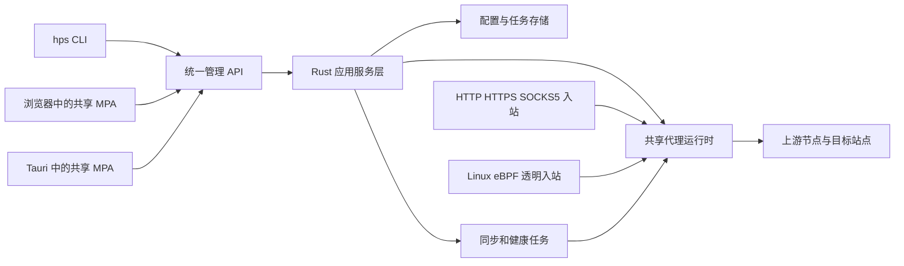
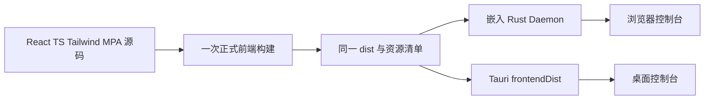

# honk-proxy-server 技术规划

- 日期：2026-11-01（Asia/Shanghai）。
- 对应任务：[Issue #2](https://github.com/go-laoji/honk-proxy-server/issues/2)。
- 文档状态：技术设计，尚未创建本文规划的 crate、命令、页面或接口。
- 关联文档：[整体规划与可行性](overall-plan-and-feasibility.md)、[控制台功能清单](console-feature-checklist.md)。
- 决策优先级：本文落实用户新增技术约束；与整体规划中的早期备选冲突时，以本文为准。
- 需求修订：[Issue #3](https://github.com/go-laoji/honk-proxy-server/issues/3) 明确 HTTP/HTTPS/SOCKS5 核心接入与短效代理提取 API 为首版主线，本文已同步调整。
- 访问模型修订：[Issue #4](https://github.com/go-laoji/honk-proxy-server/issues/4) 明确当前项目不做登录、账号验证或权限验证，任何可访问服务的使用者都可以查看并使用全部功能。

## 1. 确定的技术约束

1. 后端应用、CLI、Daemon、桌面原生控制层全部使用 Rust，不引入 Go、Node.js 或 Python 后端服务。
2. 必须提供可独立安装的 CLI 版本和 Desktop 版本，并将独立 Daemon 纳入正式交付。
3. 服务端运行不能要求启动 Desktop，也不能依赖 X11、Wayland、GTK、WebKit 或图形登录会话。
4. Server 与 Desktop 使用同一套 React + TypeScript + Tailwind CSS 页面、组件、样式和 API 客户端。
5. 前端使用真正的多页面 MPA：多个独立 HTML 入口，页面之间执行文档导航；每个页面内部使用 React。
6. Linux 真实 eBPF 是正式发布门槛，显式代理与透明代理共享同一个运行时。
7. 代理业务、配置与版本/参数校验全部在 Daemon 中执行，CLI、浏览器和 Desktop 都通过统一管理接口操作。
8. 首版核心入出站为 HTTP、HTTPS、SOCKS5，供应商核心为通过 API 拉取短效代理；标准订阅和其他代理协议作为次级扩展。
9. 当前项目没有用户账号、登录页、管理员初始化、角色、RBAC、管理令牌、登录会话、代理用户或入站身份/来源权限校验。服务可达即可直接查看和执行全部已实现功能，UI 与 API 使用同一访问模型。

供应商 API 密钥/签名、上游代理用户名密码和 TLS 服务端证书属于连接配置，仍按上游协议需要提供；它们不用于验证本项目使用者。Linux eBPF/root、系统服务安装与文件目录的操作系统要求仍然适用，不构成本项目账号体系。

“后端全部 Rust”指本项目后端代码与服务实现；所复用 honk 的加密、系统链接库与 LLVM 等原生依赖仍需按固定基线构建，不据此承诺整个依赖树均无 C/C++。

## 2. 交付形态：两个安装版本、三个独立程序

| 程序 | 职责 | 是否需要桌面 | 是否运行代理引擎 |
| --- | --- | --- | --- |
| `hps` | Rust CLI，配置、查询、诊断、自动化、本地系统服务管理 | 否 | 否，正常操作调用 Daemon API |
| `hpsd` | Rust Daemon，代理引擎、供应商同步、健康、规则、持久化、管理 API 和 Web 静态资源 | 否 | 是，唯一运行时所有者 |
| `hps-desktop` | Rust + Tauri 桌面壳，展示共享页面，管理连接档案和本机集成 | 是 | 不在桌面进程内另起一套引擎 |

### 2.1 Server/CLI 安装包

交付 `hps`、`hpsd`、默认配置、systemd unit、文档，以及与 Desktop 相同的 Web 构建产物。Web 产物默认嵌入 `hpsd`，安装完成后无需在服务器执行 Node.js、pnpm 或 Vite。

用户既可以只使用 CLI，也可以从浏览器访问 Daemon 托管的控制台。Daemon 启动不自动拉起浏览器。可另提供不含页面的精简构建，保持 API 与 CLI 功能；精简包不是唯一的 Server 发行包。

### 2.2 Desktop 安装包

交付 Tauri 应用，使用同一份 Web 产物，并按目标平台打包或配套安装同版本 `hps`/`hpsd`。Linux 完整安装需要支持独立系统服务，窗口关闭后由系统服务继续提供代理。

Desktop 可连接本机 Daemon 或远端 Linux Daemon。Desktop 自身不直接读写服务数据库，不自行执行供应商同步，不维护第二套节点健康和路由状态。

Tauri 支持嵌入外部二进制及静态前端目录，但 sidecar 的打包能力不等于系统服务安装、提权或持续运行保证；这些流程由项目单独实现和验收。[Tauri 外部程序](https://v2.tauri.app/develop/sidecar/)、[静态资源配置](https://v2.tauri.app/reference/config/#frontenddist)

### 2.3 平台交付矩阵

| 平台 | CLI | 独立 Daemon | Desktop | 透明模式 |
| --- | --- | --- | --- | --- |
| Linux x86_64 / aarch64 | 必须 | 必须，含共享 Web 控制台 | 桌面发行环境提供 | 必须支持真实 eBPF，按既定内核与拓扑基线验收 |
| macOS | 提供远程管理 CLI | 本地显式代理能力经 M0 验证后纳入；不能假定 honk-core 原样可用 | 提供本地配置与远程管理 | 首版不承诺系统透明接管 |
| Windows | 提供远程管理 CLI | 同 macOS，先验证用户态移植范围 | 提供本地配置与远程管理 | 首版不承诺系统透明接管 |

页面是否展示 eBPF 操作依据连接目标返回的能力，而非 Desktop 所在操作系统。macOS Desktop 连接 Linux 服务时，应能管理远端 Linux eBPF。

## 3. 运行架构与状态归属



状态归属固定为：

- `hpsd` 拥有供应商、节点、分组、规则、DNS、入口、健康、任务、连接和配置激活状态。
- `hps` 仅保存目标地址、连接档案和连接选项，除离线配置校验与本地系统服务命令外通过 API 操作，不保存本项目登录凭据。
- Desktop 保存窗口、主题、服务连接档案及有限的原生集成偏好，不维护项目用户或登录会话。
- React 页面保存筛选、当前选择和未提交表单；显示数据来自 API，不作为事实源。
- 服务进程是数据库唯一写入方；客户端不能以“本地模式”为理由绕过服务层直接修改数据库。

CLI、Web 和 Desktop 同时修改配置时执行同一种参数、引用和版本冲突校验，不验证使用者身份或角色。关闭某个客户端不会取消已经由 Daemon 接管的同步、探测或配置激活任务。

## 4. Rust 工作区与依赖方向

建议演进为一个 Cargo workspace，并保留一个前端工程。以下目录为实施目标，不代表当前已存在：

```text
honk-proxy-server/
├── Cargo.toml                      # Rust 工作区
├── Cargo.lock                      # 应用依赖锁定
├── apps/
│   ├── cli/                        # hps
│   ├── daemon/                     # hpsd
│   └── desktop/src-tauri/          # hps-desktop
├── crates/
│   ├── domain/                     # 领域类型、值对象、接口
│   ├── application/                # 用例、任务、配置发布编排
│   ├── infrastructure/             # SQLite、供应商适配、凭据引用
│   ├── engine-honk/                # 固定基线 honk 集成及共享运行时
│   ├── api/                        # Rust 管理 API、DTO、事件，无用户认证层
│   ├── client/                     # CLI/原生控制层复用的 Rust API 客户端
│   ├── platform/                   # 系统服务、目录、权限等平台适配
│   └── web-assets/                 # 嵌入同一份前端产物
├── web/console/
│   ├── pages.manifest.ts           # 页面 ID、HTML、入口、菜单和能力要求
│   ├── index.html                 # 默认入口/实例连接
│   ├── overview.html
│   ├── providers.html
│   ├── nodes.html
│   ├── ...                        # 其余独立 HTML 入口
│   ├── src/pages/                 # 每页 React 入口和内容
│   ├── src/shared/                # 布局、组件、客户端、适配器、样式
│   ├── dist/                      # 同一发布版本的共享静态产物
│   └── vite.config.ts
├── contracts/                     # OpenAPI 与资源/页面能力约定
├── migrations/                    # 本项目数据库迁移
├── packaging/                     # systemd、安装包和发行描述
└── docs/
```

依赖方向为 `入口 → application → domain`；基础设施实现 domain 定义的接口，由 Daemon 入口注入。`domain` 不依赖 Tauri、Axum、SQLite 或 eBPF。不要为每张表机械拆出一个 crate，原型阶段可以合并较小模块。

Desktop crate 与 CLI/Daemon 在构建依赖上隔离：发布服务器程序使用指定 package，不通过“先构建 Tauri 再导出 CLI”取得服务器程序。`hps` 不依赖 `engine-honk`；无桌面 CI 必须能单独构建 `hps` 和 `hpsd`。

当前模板的 `src`、`src-tauri`、`package.json`、锁文件均需在实施任务中明确入库和迁移范围；本次文档任务不搬动、覆盖或提交这些未跟踪文件。

## 5. 后端技术选型

| 层次 | 选型 | 约束 |
| --- | --- | --- |
| 语言与工具链 | Rust，固定工具链与 `Cargo.lock` | 以 honk 兼容性确定最低 Rust 版本；不自动追随 latest |
| 异步运行时 | Tokio | 网络 IO、任务取消、背压、受限并发；阻塞工作移出异步 worker |
| 管理 HTTP | Axum + Tower 生态 | 直接可用的 API、资源限流、静态资源、SSE；业务逻辑下沉到 application |
| 显式代理入口 | HTTP/CONNECT、TLS 代理与 SOCKS5 Rust 适配，共享 honk 拨号/转发运行时 | 不能用普通 Axum 路由或管理 API 替代完整正向代理语义 |
| 代理与 Linux 数据面 | 固定版本 honk 集成 | 出入站、健康、规则与运行代际单一归属；真实 eBPF 单独构建 |
| CLI | clap | 子命令、补全、稳定退出码、JSON 输出；独立 Rust 二进制 |
| 短效供应商 API | Rust HTTP 客户端 + 租约/批次归一化 + 受限补池控制器 | 按 API 契约获取有效期、白名单与限频；不以订阅全量替换模型处理提取批次 |
| 持久化 | SQLite + 与 honk 兼容的 rusqlite 绑定 | 使用数据库工作线程/受控阻塞池；避免在网络热路径阻塞 |
| 序列化与契约 | Serde + JSON + OpenAPI | Rust 维护 HTTP 契约，生成前端 TS 类型；构建时验证无漂移 |
| 日志与错误 | tracing、结构化错误、请求/任务 ID | 凭据脱敏；用户可操作错误码与内部错误上下文分开 |
| TLS 与上游凭据 | 经固定 honk/HTTP 客户端验证的 TLS 栈；供应商密钥/上游密码存储 | 不擅自替换 honk 的底层 TLS/QUIC 依赖；默认验证服务端证书，不设置本项目客户端身份认证 |

Axum 与 Tokio/Hyper/Tower 有明确集成边界，clap 提供独立 Rust 命令行解析，rusqlite 提供 SQLite 接口；这些是选型依据，具体版本仍以 M0 集成结果锁定。[Axum 文档](https://docs.rs/axum/latest/axum/)、[clap 文档](https://docs.rs/clap/latest/clap/)、[rusqlite 文档](https://docs.rs/rusqlite/latest/rusqlite/)

持久化优先沿用同一 SQLite 原生绑定的兼容版本，减少重复引入不同 SQLite 绑定的链接风险。本项目配置库与上游私有状态库的 schema 归属分开，不直接依赖上游内部表。若需要更换数据库访问库，应先在完整 honk 依赖树中验证兼容性。

### 5.1 首版协议矩阵与浏览器边界

| 链路 | 首版能力 | 需要明确的边界 |
| --- | --- | --- |
| 客户端 → HTTP 入口 | HTTP 正向转发、HTTPS 目标 CONNECT，无客户端鉴权 | HTTPS 目标仍保持端到端 TLS；不是 HTTPS 代理传输本身 |
| 客户端 → HTTPS 入口 | TLS 保护的 HTTP/CONNECT 代理，证书配置与校验 | 首版可采用 HTTP/1.1，不宣传未经验证的 H2/H3；浏览器配置方式单列 |
| 客户端 → SOCKS5 入口 | TCP CONNECT、域名/IPv4/IPv6 地址，仅提供 NO AUTHENTICATION REQUIRED 方法 | 不提供入站用户名密码或来源权限校验；SOCKS5 BIND 不进入首版；UDP ASSOCIATE 单列 P1 |
| 服务 → HTTP/HTTPS/SOCKS5 上游 | 协议适配、供应商认证、目标连接、到期准入 | 上游协议独立于入口协议选择；TLS 代理证书默认验证，UDP 按真实节点能力过滤 |
| Linux 透明入口 | 真实 TCP/UDP eBPF | 不因首版 SOCKS5 入站只支持 TCP 而削减透明 UDP 验收 |

SOCKS5 的 CONNECT、地址类型和 UDP ASSOCIATE 分属明确协议能力，不能因 TCP 测试通过就显示 UDP 已支持。[SOCKS5 规范](https://www.rfc-editor.org/rfc/rfc1928.html)

若供应商只有 TCP-only HTTP/HTTPS 节点，不能将透明 UDP 自动转换后送入这些节点；应补充具有实际 UDP 能力的来源，或按用户明确规则直连/拒绝。Linux eBPF 支持 UDP 与当前代理池能否提供 UDP 出口是两个需要分别报告的状态。

浏览器兼容验收须包含实际配置方式、无需账号即可接入和 DNS 行为。HTTPS 代理通常需要浏览器设置、策略或 PAC 等入口，不能把操作系统界面的“HTTPS 目标代理”误认成 TLS 代理。[Chromium 代理行为](https://chromium.googlesource.com/chromium/src/+/HEAD/net/docs/proxy.md)

HTTP/HTTPS 入站不发出本项目代理账号挑战，SOCKS5 入站协商无认证方法。上游供应商要求的用户名/密码由服务端配置并使用，浏览器无需携带供应商凭据；上游认证失败仍作为节点/供应商错误报告，不显示为使用者登录失败。

### 5.2 短效供应商适配契约

供应商首先按 `lease_api` 建模，静态来源保留作为辅助；`subscription` 为次级扩展。API 参数、签名、字段映射、提取数量/协议/地域、白名单及额度均按实际供应商文档实现，不能仅按接口 URL 和固定同步周期配置。

| 对象 | 首版字段与语义 |
| --- | --- |
| Provider | API endpoint、鉴权引用、参数/签名适配、限频、配额预算、抓取出口与 `delivery_semantics` |
| PoolPolicy | 最小/目标可用水位、最大库存、批量、提前补充窗口、最小剩余寿命、最小请求间隔和失败退避 |
| FetchBatch | 请求/批次 ID、请求时间、供应商请求标识、返回/接受/拒绝数量、预算消耗或未知状态、发布状态 |
| ProxyLease | 来源、供应商租约 ID、批次、协议、端点、凭据引用、接收/签发时间、`expires_at`、有效期依据与 `retire_at` |

`delivery_semantics` 必须区分增量租约 `append_leases` 与完整列表 `replace_snapshot`。增量批次不删除尚有效的旧批次；若接口返回的是完整列表，才按该供应商的明确契约执行缺失删除。租约 ID、认证/参数变化与端点身份一起决定是否为同一租约，不能只凭 IP:port 更新有效期。

有效期依据优先来自可信 `expire_at`/绝对时间，或按已知起算点解释 TTL。缺字段时由供应商适配配置保守 TTL，否则拒绝作为短效节点准入；`first_use` 起算只有接口契约明确且可追踪时才能使用。解析时处理单位、时区和时钟偏差，不用每次健康成功延长租约。

### 5.3 补池控制器与过期准入

```text
最小水位不足 / 批次即将退休 / 定时巡检 / 手动提取
  → 合并同来源请求、预留预算、限制并发
  → 调用提取 API，记录成功或结果不确定状态
  → 归一化租约、剔除寿命不足项、受限准入探测
  → 合并有效批次并原子发布候选状态
  → 临近到期停止新连接、按供应商行为处理旧连接、到期淘汰
```

可用水位仅计算能力匹配、健康且剩余寿命足够的节点；提取中/探测中的批次计入并发与配额预算。低水位和临近到期触发受限补充，不能让每个请求都直接提取一个 IP，也不能在来源限流时频繁补货。缺少所需协议或地域节点时按相应候选范围补充。

每次新连接先检查 `now < retire_at`、剩余寿命预算和管理状态，再检查健康与选择策略。`retire_at` 早于 `expires_at`，用于预留拨号/握手、最小会话预算和安全余量。实际业务会话可能超过租约寿命，需展示此限制并由策略控制；到期不保证既有连接存续，更不能以“排空”延长供应商租约。

提取 API 的超时和重试按是否会消耗配额判断，而非仅按 GET/POST 方法判断。支持供应商幂等键或结果查询时才使用对应恢复流程；没有重复安全保证时，响应丢失进入结果不确定状态并保守占用预算，不自动重放收费提取。429/限频按服务指示和预算退避，鉴权与白名单失败需显式处理。

短效节点采用快速且有预算的准入探测、真实连接反馈和受寿命限制的复核；临近到期不再进行无意义探测。池为空时返回明确错误或进行有上限的合并等待，不隐式直连。重启恢复必须重新核对绝对有效期，过期节点不进入候选。

初始参数只在拿到供应商真实 TTL、接口限频、计费及可用率后设置。库存、探测和补充预算应能防止空闲时持续购买大量短效节点。

## 6. 配置、持久化与运行时一致性

采用“启动配置 + 版本化业务配置 + 运行时状态”三层：

1. 启动配置使用 TOML：监听地址、数据目录、日志、TLS、引擎模式和操作系统服务参数等。供应商凭据及 TLS 私钥使用引用或私有路径。
2. 业务配置存入 SQLite：供应商、补池策略、节点/租约归属、提取批次与预算记录、组、规则、DNS 策略和配置版本；不建立本项目账号、角色、会话、管理令牌或代理用户表。
3. 运行时状态使用有界内存：活跃连接、健康窗口、选点与短期事件。任务和必要的聚合结果持久化。

发布路径为：保存草稿 → 校验 → 生成候选 → 分配版本 → 发布到用户态/内核运行时 → 记录激活结果。CLI 与 UI 展示 `configured_revision` 和 `active_revision`，不能把保存成功显示为规则已生效。

所有写请求携带预期版本，过期版本返回冲突；长任务记录实际版本及任务 ID。发布失败保留旧版本，重启时对齐记录与实际运行状态。供应商失败保留最后有效快照，但到期、撤销、禁用节点不得因缓存继续进入候选。

静态配置版本与高频租约/健康变化分别记录。业务规则未改动时，正常提取与到期不制造大量用户配置修订；运行时通过受控的池代际更新候选，并保证 eBPF/用户态映射一致。对外同时提供配置版本、池代际、有效租约数、剩余寿命和补池状态。

同一数据目录只允许一个写服务；eBPF 对象另有机器级所有权限制，不能通过更换数据目录启动第二个争抢相同 hooks 的实例。导出默认脱敏，数据库一致性备份使用 SQLite 支持的备份流程，不直接复制写入中的数据库文件。

## 7. 共用 Web 页面的构建与托管

### 7.1 一套源代码，一份发布产物



Server 与 Desktop 的菜单、表单、校验、空状态、表格、样式和业务 API 客户端均共用。禁止维护 `web-console` 与 `desktop-console` 两套页面，禁止为 Desktop 重写供应商或规则业务逻辑。

正式发行流程先产出 `dist` 与 `web_build_id`/文件哈希清单，再将同一份不可变产物分别嵌入 Daemon 与 Tauri。安装包可因平台不同而不同，页面构建清单必须一致。

### 7.2 平台适配层

共享页面通过小型 `PlatformAdapter` 获取 API base、连接档案和平台能力；它不包含用户认证、节点调度、规则或数据库逻辑。

| 能力 | 浏览器适配 | Desktop 适配 |
| --- | --- | --- |
| 页面来源 | Daemon 的 `/console/*.html` | Tauri 内嵌的相同 HTML/JS/CSS |
| API 定位 | 根据当前部署路径取得同源 API base | 从受控原生桥取得选中的本地/远程 endpoint |
| 访问模型 | 打开页面直接调用全部功能，无登录态 | 选择可达服务后直接调用全部功能，无登录态 |
| 业务调用 | 共享 API client 的 Web transport 发同源 HTTP 请求 | 同一 client 的 Desktop transport 经受控 Rust 桥请求相同 API |
| 本机集成 | 提供 CLI 指引与服务状态 | 受控文件选择、服务安装/启动、通知、托盘等 |

浏览器默认管理当前 URL 所属服务；跨域接入如有需要按 HTTP/CORS 传输行为配置，不把 Origin 名单作为使用者授权机制。Desktop 可以保存多实例连接档案；浏览器访问另一实例时直接进入其控制台地址。布局中的“当前服务”始终清晰可见，切换实例后清空旧实例查询缓存。

Desktop 只加载本地打包的可信页面，不将第三方远程网页直接载入具有原生命令权限的 WebView。原生桥限制为需要的能力与参数范围。

Desktop 默认通过 Rust API 客户端转发到已选择的 endpoint：页面提交 API 相对路径、方法和请求体，全部已实现管理 API 都可调用。桥限定协议与请求范围，不提供任意系统命令；Rust 层不附加项目账号或管理令牌，返回相同 DTO。这只是 transport 适配，不复制后端业务逻辑，也避免 WebView 混合内容和动态远程地址 CSP 兼容问题。

## 8. 真正的 React MPA 页面模型

### 8.1 页面入口约定

首版规划 18 个 HTML 入口，详细功能见关联清单；默认入口直接连接服务并进入控制台：

| 页面 | HTML 入口 | 定位 |
| --- | --- | --- |
| 实例连接 | `index.html` | 默认启动、连接恢复、当前目标实例 |
| 概览 | `overview.html` | 运行、流量、节点和异常摘要 |
| 代理入口 | `inbounds.html` | HTTP/HTTPS/SOCKS5 监听、连接限制与接入说明 |
| 供应商 | `providers.html` | 提取 API、补池水位、限额、状态与启停 |
| 供应商详情 | `provider-detail.html?id=…` | API 配置、租约、批次、有效期与提取记录 |
| 节点 | `nodes.html` | 查询、导入、批量管理 |
| 节点详情 | `node-detail.html?id=…` | 能力、有效期、来源、探测与连接 |
| 分组 | `groups.html` | 组列表、策略、当前选择 |
| 分组详情 | `group-detail.html?id=…` | 成员、回退、固定与预览 |
| 路由规则 | `rules.html` | 排序、编辑、模拟与激活 |
| 健康检查 | `health.html` | 探测策略、任务与结果 |
| DNS | `dns.html` | 上游、路由、缓存与诊断 |
| 活跃连接 | `connections.html` | 目标、规则、出口、流量与断开 |
| 日志与事件 | `events.html` | 有界事件流和过滤检索 |
| 后台任务 | `tasks.html` | 同步、探测、发布和诊断任务 |
| Linux 接管 | `linux.html` | 预检、范围、hooks、恢复 |
| 配置管理 | `config.html` | 草稿、差异、校验、激活与回滚 |
| 系统设置 | `settings.html` | 监听、TLS、资源限制、存储和版本 |

`/console/` 是 Web 的默认页面前缀，Desktop 使用本地资产根目录；所有业务页面文件名相同。页面 ID、HTML 输入、菜单项、能力要求由同一 `pages.manifest.ts` 描述，CI 检查每个条目都有真实 HTML 和 React 入口。

### 8.2 导航与状态

- 页面之间使用相对 `<a href="./nodes.html">` 文档导航，不用一个 `index.html` 加前端 Router 冒充 MPA。
- 页内筛选、排序和分页写入 query string，支持刷新、前进后退和复制链接；详情 ID 不放入敏感 token。
- 每页重新初始化 React，并共享 `AppShell`、导航、连接初始化、错误边界、API client 和样式入口，不执行登录检查或账号跳转。
- 切页会销毁内存状态，不能依赖全局 store 在页面间常驻。服务数据重新获取；筛选从 URL 恢复；未提交草稿按实例/页面隔离，上游凭据字段不持久化到浏览器存储。
- 切页前提示未提交内容，提交后展示任务或版本状态；页面重载能通过任务 ID 恢复操作进度。
- 每页只订阅自己需要的实时数据，离开页面关闭连接；刷新和重连不重复提交写操作。

### 8.3 Vite 与资源路径

沿用 Vite，并在实施时配置多个 `.html` 构建入口；当前官方构建文档使用 Rolldown 配置接口。相对资源 base 用于兼容 Web 子路径和 Tauri 本地资源环境。[Vite MPA 与相对路径](https://vite.dev/guide/build.html#multi-page-app)

首版 HTML 入口统一放在产物顶层，以降低跨环境路径复杂度。Web 服务真实返回每个 HTML 文件，未知页面返回 404，不统一重写到 `index.html`。HTML 不长期缓存，带内容哈希的 JS/CSS 使用长期缓存，升级时避免旧 HTML 引用已删除的 chunk。

Tauri 通过 `frontendDist` 嵌入目录并默认读取 `index.html`；所有页间导航、资源、刷新和返回行为必须在打包产物中验证，不能只跑 Vite dev。[Tauri 前端目录行为](https://v2.tauri.app/reference/config/#frontenddist)

## 9. React 与 Tailwind CSS 实现规范

前端固定为 React + TypeScript + Tailwind CSS，保留 Vite 构建。Tailwind 使用官方 Vite 插件集成和统一 CSS 导入；具体依赖版本随首个可构建原型锁定。[Tailwind Vite 集成](https://tailwindcss.com/docs/installation/using-vite)

- 设计变量统一定义颜色、字体、间距、圆角、边框、状态和图表色，支持亮/暗主题。
- 共享 Button、Input、Select、Dialog、Table、Badge、Tabs、Pagination、EmptyState、ErrorState 和 ConfirmDialog，统一以 Tailwind 组织样式。
- 不同时引入另一套全局 CSS 框架。复杂无障碍行为可以复用无样式基础组件，组件选型在原型阶段确定。
- 布局共享，页面内容按入口拆分；图表、日志查看器、配置编辑器按需加载，避免所有页面携带重依赖。
- 列表由服务端分页/过滤；大规模连接与日志列表使用虚拟渲染和有界缓冲，实时速率数据按采样周期聚合。
- 并行获取独立数据、去重相同请求、取消过期请求，避免串行请求瀑布。写操作统一处理任务 ID、冲突和错误提示。
- URL 是列表视图状态来源；页内状态先采用 React hooks/Context。需要额外查询缓存库时统一引入，不每页选择不同方案。
- 状态除颜色外同时提供文本；键盘操作、焦点恢复、输入标签和错误关联纳入验收。
- Tailwind 类名使用静态可发现的映射，避免运行时拼接不可扫描的完整类名。

Node.js/pnpm 仅用于开发、构建和前端测试，部署后的后端与静态资源服务完全由 Rust 完成，不需要 Node.js 常驻进程。

## 10. 统一 API、直接访问与实时事件

管理 HTTP API 使用 `/api/v1`，与代理监听端口分开。API 返回版本、支持协议、平台、eBPF 状态、构建 ID、配置版本和能力字段；客户端根据能力显示操作与不支持原因。

首版资源域包括 `status`、`capabilities`、`inbounds`、`providers`、`nodes`、`groups`、`rules`、`health`、`dns`、`connections`、`events`、`tasks`、`linux`、`config`、`settings`。不提供本项目 auth/login/session/users/roles/token 资源域。路径和 DTO 在实现前落为 OpenAPI，不能让 CLI 与页面分别猜测接口。

契约约定：

- 分页、过滤、排序统一；事件和活跃连接采用游标或有界快照。
- 标识符对前端按字符串表示，避免 Rust 整数越过 JavaScript 精度边界；这不限定数据库底层主键类型。
- 错误至少包含 `code`、`message`、`request_id`、脱敏详情和是否可重试。
- 长操作返回 `task_id`，支持查询终态；可取消与不可取消阶段由服务明确返回。
- 配置写入带预期版本；版本冲突返回 409，不静默覆盖另一客户端。
- 重复触发同步、探测和激活按资源锁、任务键或幂等标识处理，客户端超时不代表服务任务已取消。
- 供应商提取、补池策略/状态、批次记录、租约有效期和配额/结果不确定状态是首版契约；普通订阅同步不能覆盖这些语义。

访问模型：

1. 所有可达使用者可直接读取和修改全部配置、管理节点/供应商、执行探测/同步/激活和使用其他全部已实现功能；没有管理员与只读角色之分。
2. Web、CLI、Desktop 与直接 API 请求均无需账号、密码、API key、Bearer token 或登录 cookie；不实施登录会话、CSRF token 或基于使用者/来源的授权门禁。
3. MPA 切页仅恢复 endpoint、页面状态和 transport，不恢复本项目登录身份。Desktop 桥对全部业务功能一视同仁，不通过原生命令另做使用者权限分级。
4. 保留协议解析、参数/引用/版本校验、资源限额、目标能力判断、上游租约有效期和原生 API 的操作范围。这些确保操作可执行与状态正确，不区分使用者权限。
5. TLS 服务端证书和上游 API/代理认证按连接需要配置；不要求使用者提供客户端证书或管理密钥。供应商密钥和节点密码默认掩码、日志脱敏，但相关配置功能向全部使用者开放。
6. 系统服务安装、eBPF 加载和文件操作仍遵守所在操作系统要求；远端 API 不变成任意 shell 执行入口。此边界不引入本项目账号或角色体系。

复用 honk 内部管理能力时，项目统一 API 不继承其登录、管理口令或角色要求，也不让 CLI/Desktop 使用者额外取得引擎后台凭据。优先经集成层调用同一运行时；引擎内部实现细节不能变成面向使用者的隐藏门禁。

实时事件优先采用 SSE。Web transport 使用流式 fetch，Desktop transport 由 Rust 客户端订阅相同事件接口并经受控事件桥转发；两者向页面暴露相同的订阅对象，均无需登录或管理令牌。页面离开时同时取消前端与原生订阅，事件包含实例/订阅标识以拒收切换目标后的旧事件。断线重连使用事件游标，游标过期时回拉快照，随后继续订阅。

## 11. CLI 命令规划

以下均为待实现的命令设计。CLI 是完整运维入口，服务器用户无需通过 Desktop 完成配置闭环。

| 命令域 | 计划能力 | 作用范围 |
| --- | --- | --- |
| `hps init` | 创建初始配置和数据目录参数 | 本地离线/引导，不创建账号 |
| `hps profile` | 添加、选择、检查本地/远端连接档案 | CLI 本地档案 |
| `hps status` / `version` | 运行状态、版本、能力和当前目标 | 目标 Daemon/本机 CLI |
| `hps inbound` | HTTP/HTTPS/SOCKS5 无认证监听、接入说明、资源限制与启停 | API |
| `hps provider` | 列表、增改、启停、提取、补池策略/状态、批次、预算和历史 | API |
| `hps node` | 查询、导入、租约/剩余寿命、探测、启停、排空 | API |
| `hps group` | 成员、策略、固定选择、回退 | API |
| `hps rule` | CRUD、排序、校验、模拟 | API |
| `hps health` / `dns` | 策略、探测、解析诊断、缓存 | API |
| `hps connection` / `events` / `task` | 查询、过滤、跟踪、断开、任务终态 | API |
| `hps config` | 导出、离线校验、差异、激活、回滚 | 显式区分离线与 API |
| `hps linux` | 环境预检、接管状态、作用范围、诊断 | 目标 Linux API；本地检查显式标识 |
| `hps service` | 安装/卸载、启动/停止/重启、开机启动 | 仅本机系统服务管理 |
| `hps ui` | 输出控制台 URL；显式 `--open` 才打开浏览器 | CLI 本机行为 |

全局约定：`--profile`、`--endpoint`、`--config`、`--timeout`、`--output json`、`--no-color`。非交互脚本提供明确的确认参数；正常输出进入 stdout，诊断和提示进入 stderr，JSON 模式不混入进度动画。

初始退出码建议：0 成功、2 参数或本地配置错误、3 无法连接目标、5 服务业务拒绝、6 等待超时/任务失败、7 版本或配置冲突；不设置本项目登录/权限失败分支。最终含义写入 CLI 契约并保持兼容。

`hpsd` 默认以前台进程运行，供 shell、systemd 或容器监督器管理；不默认双重 fork。SIGTERM 执行受限排空和资源清理；不能通过远端 `hps service restart` 意外重启 CLI 所在机器，远端与本地动作在帮助和输出中明确区分。

## 12. Daemon 与 Desktop 生命周期

### 12.1 无桌面部署闭环

Server 的安装与运行闭环为：安装二进制 → 生成配置 → 环境预检 → 安装 systemd 服务 → 启动 → CLI 查看状态 → 代理接入。浏览器控制台是可选管理入口，不是服务启动依赖；首次访问直接使用全部功能。

Daemon 按顺序完成：实例锁、启动配置、数据库迁移、恢复有效快照、引擎/入口和后台任务、就绪信号。引擎失败时不发布“代理就绪”；可在明确的维护模式下保留本地诊断 API，状态与退出策略需可配置、可测试。

支持正常停止、异常退出恢复、重复启动拒绝、日志轮换、数据目录的操作系统权限、备份恢复和版本回退。监听地址与 TLS 可配置，服务在其监听范围内向所有可达使用者开放全部功能，不要求额外配置登录或访问权限。

### 12.2 Desktop 的连接方式

首选连接已安装的本机系统服务，或显式选择远端服务。尚未安装服务时展示安装/连接引导，不因为打开窗口就隐式启动一个 root 代理。

开发期可以提供受控的临时 sidecar 运行方式，但它与持久系统服务必须分别命名和展示：临时进程不承诺窗口退出后继续运行；正式持久模式由系统服务保证。检测端口、实例锁与服务身份，避免连接到错误实例或重复启动代理。

Desktop 提供托盘、窗口与通知、控制台入口、系统代理设置和本机服务管理。修改系统代理前保存原设置，恢复时确认仍属于本应用设置；不覆盖用户后来改过的代理配置。桌面自动启动和代理服务开机启动是两个独立选项。

Linux eBPF 所需权限由受控系统服务承担；WebView、React 页面和整个桌面应用保持普通用户权限。

## 13. Linux eBPF 的实现约束

沿用前期核查的 honk 基线 `54b2e1cfbe1e7f8a93dba3a0f64fabf2a9f88e38`，不在本次规划中升级上游。内核 6.12+、cgroup v2、BTF、bpffs、真实对象构建等要求见[整体规划第 8 节](overall-plan-and-feasibility.md#8-linux-ebpf-专项方案与发布门槛)。

项目需要保证：

- 真实 eBPF 与普通显式代理功能通过 target/feature 隔离，非 Linux 构建不拖入 Linux 数据面依赖。
- HTTP/HTTPS/SOCKS5 和透明 TCP/UDP 进入同一个路由、分组、租约准入、健康、运行代际与出站机制。
- 供应商下载、探测、DNS、管理连接和代理出站均处理 bypass，避免重复接管。
- 数据面能力区分 `supported`、`configured`、`attached`、`ready`，记录实际失败原因。
- 动作按目标服务执行；Desktop 所在操作系统不决定目标能力。
- 未满足内核条件时明确拒绝 eBPF 模式，不静默显示成功或退为 mock。
- 用户态“无可用节点拒绝”与进程崩溃后的系统流量行为分开说明；严格 kill switch 如纳入范围需单独实现与验收。

Linux 发行包必须包含经过验证的真实 eBPF 对象，并在无桌面机器上验证本机/LAN、TCP/UDP、DNS、IPv4/IPv6、重载、异常退出和资源清理。页面只能展示真实状态，不能通过按钮状态推断已经挂载。

## 14. 构建、测试与发行

### 14.1 构建产物

| 产物 | 构建范围 | 运行环境要求 |
| --- | --- | --- |
| CLI | `hps` 独立 package | 不需要 GUI 或前端运行时 |
| Server 标准包 | `hpsd` + `hps` + 共享 Web 资产 + Linux eBPF 对象 | 无桌面 Linux，满足所选模式权限 |
| Server 精简包 | `hpsd` + `hps`，关闭 Web 资产特性 | 保留 API，省略页面；eBPF 要求不变 |
| Desktop | Tauri + 相同 Web 产物 + 配套程序 | 对应平台 WebView/桌面运行环境 |

CI 分别构建 package/target/feature 组合，服务器流水线不构建 Desktop；不能用跨平台统一 `--all-features` 代替能力矩阵。Node.js 只在构建阶段准备前端静态资源；仅构建纯 CLI 时不应要求先生成前端。

### 14.2 验证矩阵

| 验证类型 | 关键验收 |
| --- | --- |
| 无桌面安装 | 无 `DISPLAY`/桌面会话环境启动 hpsd；检查服务器包依赖无 Tauri/GTK/WebKit；CLI 完成主要配置操作 |
| API/CLI 一致性 | 无账号、cookie 或管理令牌时，CLI/UI/直接 API 均可读写全部功能，版本与错误语义相同 |
| MPA 完整性 | 18 个 HTML 独立存在；逐页直接打开、刷新、前进后退、query 恢复、未知页 404；没有登录跳转 |
| 共用资产 | Server/Desk 同版本文件清单与 `web_build_id` 相同；业务组件无分叉 |
| Web 部署 | 根路径和子路径、静态资源缓存、TLS、直接读写、SSE 重连与旧资源更新；空浏览器存储也可用 |
| Desktop | 打包后本地资产导航、CSP/IPC、原生 transport/订阅取消、目标恢复/切换和系统服务生命周期，无用户登录依赖 |
| Rust 运行时 | 同步/探测限并发、版本冲突、失败恢复、重试边界、到期排除和快照一致性 |
| 浏览器核心协议 | HTTP/HTTPS/SOCKS5 入站无需账号；HTTP/HTTPS 目标、TLS 代理、TCP/域名/IPv6、配置与 DNS 行为通过；上游认证由服务端处理 |
| 短效 API | 连续批次增量合并、提前补池、低水位、限频、结果不确定、无配额、TTL 单位/时区、临界到期、重启与时钟变化 |
| Linux 数据面 | 真实 hooks/maps 与出口证明，覆盖整体规划中 TCP/UDP 和恢复矩阵 |

Rust 运行格式、lint、领域/集成测试；前端运行类型、构建、组件关键行为和页面 E2E。文档规划阶段仅检查文档契约，不把尚未实现的测试写成已通过。

## 15. 实施阶段与交付条件

此处 M0–M6 是实施里程碑；控制台清单中的 P0/P1/P2 是功能优先级，含义不同。

前期整体规划中的 8–14 人周是早期范围估算；独立 CLI、共享 MPA、原生 transport 与跨平台管理要求已在本文细化，应在 M0 后按完整功能清单重新估期，不直接沿用为这次全部交付的工期承诺。

| 里程碑 | 交付 | 通过条件 |
| --- | --- | --- |
| M0 集成验证 | 固定 honk、核心三协议、短效 API 租约原型、真实 eBPF、三程序骨架、3 页 MPA 原型 | 无桌面启动；同一 dist 两端切页；HTTP/HTTPS/SOCKS5 与短效批次/到期证明；真实代理流量与挂载证明 |
| M1 后端与契约 | 配置、直接访问的 API/OpenAPI、数据库、任务、CLI 基础 | CLI 无账号即可独立读写配置/查询；版本冲突一致；服务器不需要 GUI |
| M2 代理与节点闭环 | 核心三协议、多来源短效提取、批次租约、补池/预算、健康、组与规则 | 真实短效 API 至选点/到期闭环；增量不误删有效节点；补池不超预算；失败不误直连或盲目重放提取 |
| M3 Linux 完整验收 | 透明 TCP/UDP、DNS、生命周期、systemd、诊断 | 真实 Linux 与双架构测试通过，服务持续运行不依赖 Desktop |
| M4 共享控制台 | 所有 P0 页面和功能、MPA 导航、任务/错误/冲突状态 | 浏览器与 Desktop 使用同一功能和资产，CLI 覆盖 P0 运维能力 |
| M5 Desktop 集成 | 本地/远端实例、系统服务、托盘、系统代理恢复 | 关闭窗口不影响已安装服务；切实例清理缓存；无需登录即可使用全部功能 |
| M6 稳定性与发行 | headless/desktop 分包、回滚、压测、恢复文档 | 发行二进制与安装包验证通过，打包版本与契约一致 |

现阶段不因 UI 开发方便而降低 Linux eBPF 发布要求；M0 必须先完成真实数据面验证。跨平台本地代理属于需验证的能力，远程管理客户端不能被描述成已经提供本地完整代理引擎。

## 16. 本次交付边界与后续决策

本次交付技术文档和控制台功能清单，不修改 Cargo/前端配置、安装依赖、迁移模板或创建可运行程序。后续实现以这两份文档作为拆分 Issue 和验收的基础。

已确定：全 Rust 后端、CLI/Desktop/Daemon、共享 React/Tailwind 真正 MPA、HTTP/HTTPS/SOCKS5 核心协议、短效提取 API 与租约补池、Linux eBPF 必需、无账号且全部功能直接可用、API 单一入口、运行时与数据库单一所有者。

M0 需要验证后决定：honk 直接 crate 集成还是必要 fork、非 Linux 用户态依赖边界、Tauri 打包后的 MPA 导航/CSP/原生 transport 与直接访问行为、SQLite 依赖兼容版本、具体供应商 API 以及前端最低 WebView 支持范围。具体库版本和性能指标在验证后锁定，不以本文中的候选选型替代编译与真实流量证据。
