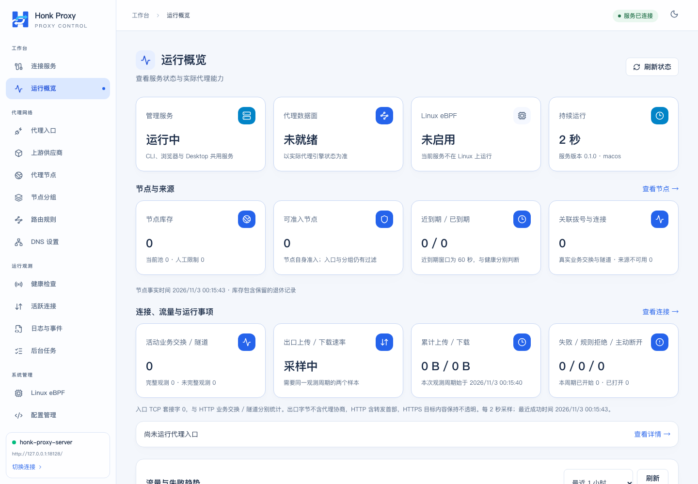
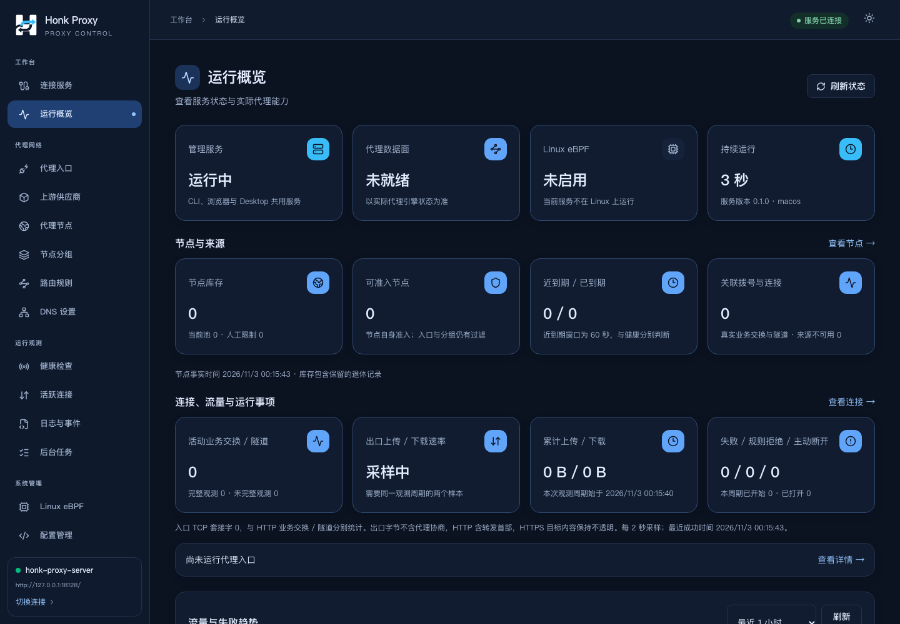

# Honk Proxy 正式品牌资源与组合验收（#28）

用户于 2026-11-03 明确确认蓝色 H + 双向通路 Logo，以及组合预览的 LIGHT 配色，并授权生成全部用途图标与产品替换。已通知现有配色任务按确认图对齐；该任务最终 `5f17b53` 已通过 `904640f` 合入 Logo 功能分支。没有执行 finish、push 或合入 develop/main。

## 交付

- 唯一母版：`assets/brand/honk-mark.svg`；所有 PNG、深色、单色和应用图标均从其路径导出，不裁切 AI 概念图。
- 68 个导出文件及 SHA-256：`assets/brand/assets-manifest.json`。透明图形覆盖 16/24/32/48/64/128/256/512/1024；浏览器覆盖 SVG/ICO/16/32/48 PNG、180 touch icon 与 192/512 图标；Tauri 覆盖 PNG、ICO、ICNS、Windows Store 尺寸及 22/44 单色托盘模板。
- 共享 `BrandLogo` 在所有页面随应用主题切换；18 个 HTML 入口具有同一组 favicon/touch icon/manifest 链接。Daemon 对 ICO 和 Web Manifest 返回对应 MIME。
- macOS 托盘使用原生 template；应用、窗口、Dock 及其他平台默认图标使用蓝色应用图标。保留原有轻动效和减少动态效果。
- 资源归档 `target/brand-delivery/honk-proxy-brand-assets.zip`，含 73 个文件（图标、母版、清单、说明、导出脚本和 Web Manifest），569681 字节；SHA-256 `51472a195954d04f24d6e08251b51db878cb1ea6efb90bfa05c2475fa5d31519`。

## 验证

| 验证项 | 结果 |
| --- | --- |
| `pnpm typecheck`、`pnpm format:check`、18 页 `pnpm build` | 通过 |
| 根工作区及独立 Tauri 的 `cargo fmt -- --check` | 通过 |
| 导出完整性与重复生成 | 68 项哈希一致；PNG/ICO/ICNS 重复导出字节完全一致 |
| 小尺寸检查 | 16/24/32/48/64 实际像素与深浅/单色图形已检查；ICO 含 16/24/32/48/64/256，ICNS 含 1x/2x 原生尺寸 |
| 真实 Daemon + Chromium 组合验收 | 9 项通过：18 页品牌引用、资源 MIME/构建 ID、主题 Logo/MPA/减少动态效果、新文档导航、共享资源逐字节哈希、移动端、真实入口控制、配色对比度与刷新动效 |
| macOS ARM64 release Daemon + Tauri `.app` | 构建通过，Desktop、随包 Daemon 与共享 Web Manifest 一致 |
| 原生图标与签名 | 包内 ICNS SHA 等于正式资源；44×44 模板的完整 RGBA 存在于编译后二进制；`codesign --verify --deep --strict` 通过 |

首次 Chromium 运行被沙箱拒绝创建 macOS Mach IPC 端口，未计为产品失败或通过；获得所需执行权限后，同一组 9 项全部通过。没有运行旧网络写入测试或完整 Rust 宿主网络测试。

配色任务此前针对其最终确认图层次完成 27 项完整浏览器回归，最终细边框追加 3 项专项检查；此处的 9 项是 Logo 合并后的独立组合验收，不与该任务计数相加。

## 真实页面

以下截图来自临时内存 Daemon 的真实页面，使用测试配置，不是 AI 概念图。

[移动端导航](brand-assets-2026-11-03/mobile-dark-navigation.png)。

## 冻结源码与产物

- 编译源码：`c79e07dc626f37fb41d78b83fa340648afe7968f`，`source_dirty=false`；随后提交的内容仅为验收文档和截图。
- Web Build ID：`0b385d0e1a38e8b057fa59dcec0b045d994224881b918d2122ecaa2fd1df96d6`。
- 图标 ICNS SHA-256：`f1e0ab467b2c8982a702ef31b4caace323287eb3750331a345ff2372551b891f`。
- macOS app：`/private/tmp/hps-logo-tauri-target/release/bundle/macos/honk-proxy-server.app`（29.89 MiB）。
- 包清单：`target/brand-desktop/desktop-manifest.json`；机器可读结果见本目录 `brand-assets-2026-11-03.json`。

## 验收边界

没有启动原生窗口或观察菜单栏托盘的实际系统呈现；已验证模板接入、编译图形与打包内容，不将其记为原生可见窗口验收。macOS 包为本地 ad-hoc 签名，未公证或发布。Windows/Linux 图标已生成，但本轮没有编译或安装其原生包；iOS/Android 不在当前产品平台范围。

开发与测试进程设置 `HPS_FORBID_HOST_NETWORK_CHANGES=1`。未修改开发宿主 Wi-Fi/DNS/路由/代理，未覆盖已安装 Desktop bundle、偏好或原始 target，原始未跟踪素材保留。全部操作在独立 Logo worktree 与专用构建目录完成。
